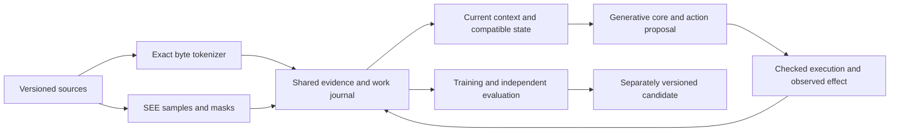

# nano'ai

nano'ai is a local research system for connecting language, persistent evidence,
actions and learning. It keeps the original source, the alternatives considered,
the result of an action and the reasons for revising a judgment. The aim is a
capable resident core that learns from experience while making fewer mistakes
and recovering well when it does make them.

The current implementation has an exact byte tokenizer, a journal-backed language
and perception catalogue, typed operations, recoverable local artifacts and an
original-BF16 model interface. Its learning experiments have produced real updates
and recoverable state. **No learned candidate has yet earned admission through a
reliable task-quality improvement.**

Argon and other contributors can start with the [project handoff](docs/start-here.md).
It includes the [complete architecture](docs/whole-system.md),
[all retained requirements](docs/requirements.md) and the [reviewed pi proof](docs/pi-proof.md),
with runnable consumers and explicit evidence boundaries.

## Try the frozen tokenizer

Use Python 3.14 or newer, a C++20 compiler and OpenSSL development files.
`pkg-config` locates OpenSSL, or set `NANOAI_OPENSSL_ROOT` to its installed prefix.
From this checkout:

```sh
python -m pip install ./packages/nanoai-tokens
python -m pip install -e .
python - <<'PY'
from nanoai.master_tokenizer import MasterTokenizer

codec = MasterTokenizer.load("data/master-tokenizer-v1/master.nmt")
raw = "İstanbul, 雨 and 🧬".encode("utf-8")
record = codec.encode(raw)
assert codec.decode(record) == raw
print({"input_bytes": len(raw), "pieces": len(record["spans"]),
       "restored_exactly": True})
PY
```

This path uses the independently installable [nanoai-tokens](packages/nanoai-tokens)
package and requires no neural model or service. Its C++ core runs inside Python;
the checkout's data path resolves to the same packaged frozen artifact. There
are 24,664 active literal pieces and three separate model control rows. Every
byte has a fallback, so nulls, invalid UTF-8 and partial-character pieces remain
recoverable.

The [tokenizer guide](docs/master-tokenizer.md) explains the law, native C++20
consumer, IDs, limits and measurements. The
[version manifest](data/master-tokenizer-v1/manifest.json) records the source
revisions, selection policy and qualification. The small authored corpus qualifies
this first lexical version; general-language quality remains an evaluation task.

## Keep observations and their history

The [catalogue guide](docs/catalogue.md) contains a complete model-free example.
It records a text observation against an exact source revision and tokenizer,
recovers it in a new process, and shows how a correction changes the current view.

New durable states use standard-library SQLite with exact event history and
verified recovery. Existing SJQL states remain supported through their original
package or `NANOAI_SJQL_SRC`. The [storage guide](docs/storage.md) records the
comparison, transaction contract and compatibility boundary.

Each observed piece carries its byte barcode, exact span, source and native
witnesses when the matching inventory is supplied. Followers count literal
sequences within observations. SEE references add checked image samples and
masks in source-pixel coordinates. Meanings and neural updates retain their own
assessment records. Explicit API and CLI observations share the catalogue with automatic observations of generated writing artifacts.

## How the parts fit



A visible yes/no/both judgment projects a richer set of linked alternatives.
Identity and relations remain available when a question is open. A source
correction invalidates affected work while retaining the original evidence.
General authoring, writing and authored teaching use one task-input envelope;
the journal supplies selected current context to serving consumers.
Repeating completed writing verifies the actual artifact before worker startup;
selected source or working-state changes require a new generation.
Exact operations enforce their stated contracts; learned interpretation and
choice remain fallible. Evaluation therefore measures errors, consequences,
correction and retention across complete tasks.

The intended neural destination joins language, recurrent working state, causal
chunking and action heads in one trained core. Current Qwen instruments and small
selectors are separately identified experiments. Original model files stay at
their declared BF16/F32 precision. The [design](docs/design.md) and
[System Zero contract](docs/system-zero.md) explain the chosen interfaces and
which neural mechanisms still need training.

The [execution wiring](docs/wiring.md) assigns each component its role and
separates artifact delivery, natural generation termination and assessed task
success. Recovery retains failed attempts while keeping their obligations open.

## Native models and experiments

Real generation needs an explicitly qualified original-BF16 model and a compatible
`llama-server` build. Payloads and machine-local paths are supplied separately.
[Workflows](docs/workflows.md) covers admission, reviewed calculations, scratchboard
use, publication, recovery and the existing learning commands.

Optional dependency groups are scoped by use:

| Extra | Use |
|---|---|
| `tokenizer-sources` | Read and exercise the pinned native tokenizer formats |
| `perception` | Inspect SEE mask PNGs through Pillow; a SEE native executable is also required |
| `syszero` | Earlier Qwen/Kimi vocabulary adapters |
| `learning` | Bounded NumPy/PyTorch selector experiments |
| `generative` | Full-source PyTorch/Transformers adaptation and recurrent-state experiments |

The tokenizer's native consumer requires C++20 and OpenSSL libcrypto. The separate
BF16 harmony codec uses C++17 and macOS Accelerate. Their current executed native
qualification is macOS arm64. Windows and Linux retain their own checks.

## Evidence and development

[Measured results](docs/results.md) includes the failed and incomplete runs as
well as successful representation and recovery checks. The
[semantic-data contract](docs/meaning.md) distinguishes byte restoration,
contextual meaning and learned transfer. The
[evaluation contract](evals/CONTRACT.md) defines the original consumer checks.

From a matching environment:

```sh
PYTHONPATH=src python -m unittest discover -s tests -v
```

Native tests need explicitly selected dependencies. Set `NANOAI_HARMONY_LIB` to
the built harmony library and `NANOAI_BF5P_REFERENCE` to the independent existing
BF5P encoder. `NANOAI_SEE_EXECUTABLE` enables the actual SEE bundle test;
`NANOAI_TUPLEHASH_PYTHON` selects a Python with `Crypto.Hash.TupleHash256` for its
independent digest reference. Absent native dependencies are reported as skips.
Set `NANOAI_MASTER_NATIVE` to the compiled master-tokenizer executable for
its native differential tests. The [tokenizer guide](docs/master-tokenizer.md)
gives the build command and additional C++ API qualification path.

Model weights, adapters, feature caches and live journals belong in private local
storage. Source payloads retain their individual licenses and provenance. This
repository's tests and measured examples establish their stated scopes; broad
semantic learning, useful continuing agency and final user acceptance remain
separate outcomes.
