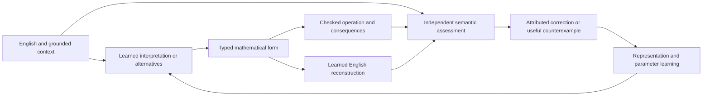

# English, mathematical meaning and experience

The core-data requirement is bidirectional: English should identify a mathematical meaning in context, and the mathematical representation should support an English expression with the same meaning. Source: user message `msg_01a13684-b299-7d31-a12a-f9d656835f8d`, 13 October 2026. This extends the existing generative learning task and its full retained architecture.

Three separate checks make that requirement concrete:

1. The source record and lexical codec preserve the original wording exactly.
2. The interpretation preserves referents, relationships, conditions, scope and uncertainty. Equivalent paraphrases may have different bytes. An unresolved reading retains alternatives.
3. Execution produces the consequences specified by that interpretation. A correct computation of the wrong interpretation fails the task.

The semantic structure is a training and checking interface inside the shared core. It complements continuous learned representations and the exact work graph. It does not claim to define every ordinary English concept with a fixed formula. Context, perception and experience supply meaning that an isolated sentence can leave open.

## Data and learning contract

A teaching record connects original English, source-bound referents, a typed mathematical form, assumptions, executable observations, a faithful English reconstruction and checked counterexamples. A correction retains the previous interpretation and its failure. Training includes both directions, execution predictions, useful inquiries, and changed assumptions. Later examples combine familiar components in previously unseen structures and contexts.

The first executable fragment reuses the existing finite relation owner. Its propositions describe named conditions. Negation, conjunction, inclusive disjunction, exclusive disjunction and equivalence compose those conditions. Each formula denotes a Boolean function over all assignments in its declared finite context. An independent evaluator compares these functions, so equivalent formulas can pass without copying one preferred syntax. Empty evidence, two possible values and inconsistent premises retain their existing different meanings.

The canonical English grammar is a bounded checking language. The learned model receives additional natural paraphrases and must select the mathematical form itself. A handwritten renderer/parser qualifies the data and reverse-output checker; it is never reported as learned interpretation. A model-generated paraphrase outside the admitted checker is recorded as unsupported rather than certified or declared logically false. Wider language needs wider independently assessed data.

Exact quantities, units, temporal relationships, typed programs, geometry and uncertain models extend this same record structure through their existing owners. They retain their own semantics and operational checks. The finite predicate fragment is a first qualification surface, with its scope visible in every result.

## Beyond a parameter optimizer

Backpropagation computes credit through differentiable operations. It does not decide which observation to obtain, which hypothesis to test, how to represent a new operation or whether a learned change improves completed work. The complete system includes these decisions and observes their consequences.

The exact relation owner can construct a separating assignment when two interpretations disagree. That assignment is a concrete next experiment: predict each outcome, execute the admitted operation, retain the result, and revise the surviving interpretations. This form of hypothesis revision uses executable counterexamples. A neural update must separately make the correct interpretation easier to produce on unseen tasks.

Dust provides a candidate activation-credit estimator; EGGROLL provides structured parameter-perturbation credit. Their source claims and local limits remain in the parent project's `audit/capability-learning-20261013/dust-review/ASSESSMENT.md`. They compete with qualified gradients at named causal boundaries. An optimizer comparison cannot by itself establish semantic grounding or general intelligence.

## Evaluation

Compare the unchanged full original model, current verified examples in context, and a separately saved learned candidate. Preserve complete source computation and original precision. Training and model selection receive no confirmation labels. Hold out composition, paraphrase, argument roles and referent combinations; random row splits would overstate the result. Evaluate the whole path from interpretation through execution and English reconstruction, including ambiguous and out-of-scope inputs, source correction, recovery and total cost.

The compositional split is informed by [COGS](https://aclanthology.org/2020.emnlp-main.731/) and [SCAN](https://proceedings.mlr.press/v80/lake18a.html). These are primary research references for the evaluation design, not imported datasets or claims about nanoai. Current implementation and learned outcomes are recorded separately in the task's audit evidence.
