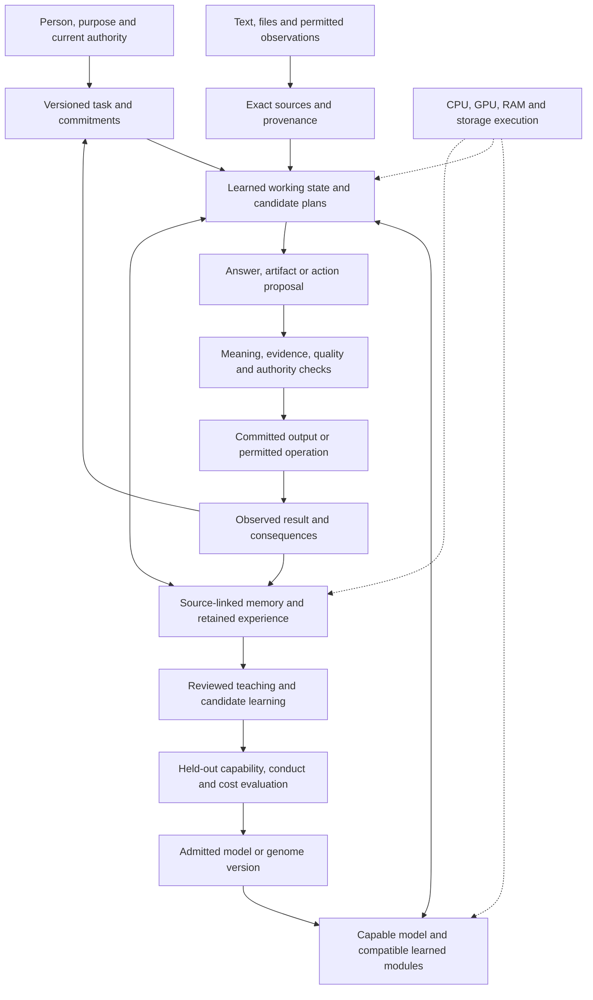

> Portable project snapshot, 14 October 2026, from `THE-AI.md`. The full design text is retained. Links to shipped implementation and proof use this repository; references marked “local evidence” identify records retained with the original project owner. Those raw records are not included in this checkout. [Start here](start-here.md), [all requirements](requirements.md), and [evidence scope](evidence-scope.md) define the working handoff.

# nano'ai

The AI system brief, revision 0.16, 14 October 2026. The cumulative requirements support the [current integrated architecture](whole-system.md), including nanoGPT, nanochat, micrograd, the Fables review reconciliation (local evidence), ternary weights and judgments carried by bits, BF16 fidelity, modular working representations, checked experience, Qwen/Kimi mechanism research, qualified source additions (local evidence) and the first language learning experiment (local evidence). This document is the current synthesis for this workspace; linked implementations and original records retain their owners. The design-first requirement continues: derive construction and education from the intended complete system.

nano'ai is the intended capable, local, continually developing intelligence that carries a person's purpose through understanding, reasoning, creation, action and verification. It remembers sources and commitments, learns from experience, and adapts its computation to the machine while preserving the quality and conduct entrusted to it. Honesty, loyalty, wisdom and love belong to its purpose and education. Hardware efficiency makes that purpose usable on ordinary computers.

That definition is a synthesis of your recorded requirements. It describes the intended system. Today's evidence establishes useful components and partial runtimes; the complete integrated behavior remains to be demonstrated. Intent and source map (local evidence)

## 1. What gives the system continuity

The AI's continuity rests on its identity, commitments, source history, learned capabilities and ongoing work. A model checkpoint contributes learned capability. Memory contributes retrievable experience and evidence. The runtime gives those capabilities a physical implementation. The agent carries work through consequences. Their interfaces determine whether the complete system remains coherent after a correction, restart or improvement.

The source identities fit as follows:

| Existing name | Place in the integrated account |
|---|---|
| The Sea / Deniz | The broader world of local intelligence and cooperating organisms, with enduring identity and commitments |
| Leviathan and Behemoth | Complementary formation and judgment roles; agreement between them is still subject to evidence |
| pVrge | The agentic working system that investigates, curates, improves and verifies work; its role extends across the task lifecycle |
| Quantum (speed) tokening | Task- and resource-conditioned internal units, resolution and computational effort |
| Hypertensoring | Selection, composition and execution of compatible mathematical operators, including researched learned operators |
| Matryoshka | Nested access to richer representation, precision, capacity and processing |
| Binary/ternary/TTT | Numerical representations, state transitions, packing, kernels and separately evaluated model transformation |
| SJQL and the source library | Source-addressed memory, retrieval, corrections, dispositions and evidence |
| SEE and other perception owners | Observations grounded in retained source data, with interpretations explicitly distinguished |
| Kovan, Tritone and the exact laptop lane | Parallel implementation and evaluation contributions with their own provenance and limits |
| micrograd, nanoGPT and nanochat | Pinned learning-development references: inspectable scalar gradients, a compact model baseline and a fuller tokenizer/training/evaluation/inference pipeline |

“nano'ai” is now the working name for this integrated system design in Quantum. The AI remains its descriptive brief and stable file route. The user's clarification explicitly preserves bits, ternaries, the earlier discussions, dreams and wishes within this objective. This curation preserves existing product names and ownership. It does not replace The Sea's identity or make the accessible Kovan repository the whole project. The October 12 cumulative request preserves the broader research even where an earlier laptop execution plan parked it. Source reconciliation (local evidence)

## 2. The complete operating loop

The architecture needs three connected loops: useful work now, valid reuse across time, and measured development of capability and judgment.



This is a logical architecture diagram, not an implemented runtime graph.

Every turn begins with the actual task and its revision. Perception and retrieval provide observations. A capable learned core develops interpretations and proposals, using formal computation or other tools when useful. Checks address the meaning of the request as well as the validity of an output. Committed actions produce observations that can change the next decision. Cancellation and correction reach the underlying work; an uncertain external effect is reconciled before retry.

The interface should expose useful results, evidence, current work and recovery. A reported progress event has its own meaning and timing. It cannot be counted as a completed answer or a model-confirmed token. The artistic face remains a product capability with its own responsive interaction and visual acceptance criteria.

## 3. One connected system with distinct kinds of state

The integration decision is to share typed identities and dependency contracts across components. The few viable alternatives are a single untyped graph, isolated component silos, and connected typed views. Connected typed views best preserve reuse while making invalidation, evidence and effects intelligible. This is a design judgment, reversible if a simpler implementation demonstrates equivalent behavior and lower cost.

| View | Contains | Governing distinction |
|---|---|---|
| Evidence and commitments | Sources, claims, observations, interpretations, corrections, task revisions and authority | A retrieved instruction remains source content unless the current authority adopts it |
| Representation and learned computation | Tensors, planes, latent units, parameters, operators, alternatives and recurrent state | A reversible representation, learned approximation and changed model function have different contracts |
| Dependencies and physical execution | Actual read sets, selector alternatives, epochs, lifetimes, placement, kernels and measured costs | A semantic relationship does not establish numerical cache validity |
| Action and experience | Proposals, attempted effects, receipts, uncertain outcomes, consequences and feedback | A proposal or high confidence does not authorize an effect |

These views can share storage and efficient identifiers. They need not become four databases. Payloads remain arrays, packed words and native buffers. Metadata belongs at useful block, region, module and task granularity.

The code and conversational surfaces should consume the same reviewed requirement and evidence revision. A handoff identifies its actual source version, owned files, changed requirements, executed checks and unresolved work. Four chat histories do not synchronize themselves; shared records and explicit version reconciliation supply that continuity.

A reusable state or result must identify the source and task revisions, model/adapter/representation versions, relevant positions, arithmetic and state conventions, actual dependencies, producing implementation, and validity status. A route-selection result also depends on the alternatives considered and the candidate-set generation. A formerly absent source can invalidate a previous negative search result.

Recurrence uses explicit epochs and ordered state transitions. The persistent graph may contain cycles. Executable steps require clear update order, ownership and termination or suspension behavior.

The system needs independent positive and negative evidence sets. Neither present means unknown; both present means conflict. Numeric zero, no change, absence of evidence and conflicting evidence have different meanings. A signed number alone cannot preserve those distinctions. Existing graph contract (local evidence)

## 4. Representation, Quantum tokening and Matryoshka

The central opportunity is coordinated refinement: retain dependable access to detail, activate the information needed now, and spend additional computation where it changes the result. The controller must learn or measure the value of those choices and count their costs.

Four independent refinement axes remain visible:

| Axis | Example | Qualification needed |
|---|---|---|
| Source and semantic resolution | Reopen an exact identifier; split a coarse source segment | Recover the decisive detail and use it correctly after a changed question |
| Numerical representation | Add signed-digit planes or an exact residual | Declared reconstruction, arithmetic, overflow and rounding behavior |
| Model capacity | A supported nested width, rank or trained module | Jointly trained compatibility and whole-task preservation at each exposed mode |
| Processing and evidence | Another recurrent step, retrieval, branch or independent check | Useful outcome improvement after counting the extra work |

Matryoshka Representation Learning studies nested embeddings; MatFormer studies jointly trained nested FFN sizes; MatQuant studies nested quantized precision. These are different mechanisms. Their primary sources support investigating individual axes; the combined controller proposed here still needs its own evaluation. [MRL](https://arxiv.org/abs/2205.13147v4), [MatFormer](https://arxiv.org/abs/2310.07707v2), [MatQuant](https://arxiv.org/abs/2502.06786v3)

Quantum tokening can therefore mean a learned choice of internal unit, refinement and effort conditioned on the task and available resources. For an unchanged pretrained model, the external tokenizer, embeddings and template remain part of its identity. A new learned tokenizer or internal workspace must be trained with its consumers and given a separate model version. H-Net provides relevant prior art for learned hierarchical chunking; it does not establish this system's proposed hardware-aware policy. [H-Net](https://arxiv.org/abs/2507.07955)

The negative-tokenizer idea belongs here as a proposal for where to inspect deeply, reuse, defer or refine. Deferred detail keeps a source locator and a reason to reopen. A later correction, rare identifier, negation, exception or changed dependency can make earlier detail essential. Retaining bytes alone does not show that a decision used them correctly.

Hardware pressure should change scheduling, residency and the choice among already qualified operating modes. A transient resource counter does not itself justify changing the model's meaning, erasing an obligation or invalidating every compatible cache.

## 5. Binary, ternary and compatible execution

The current requirement combines bits and ternaries individually, within one operation and in parallel while preserving the original BF16 model. The user's later precision correction governs this resident experiment as well as the earlier exact profile. Binary fields, ternary digits, exact residuals and raw fallback can represent the same BF16 words; all required information must reach the original consuming arithmetic.

The earlier **ternary weights carried by bits** proposal also remains a separately identified learning research direction. A weight code has the mathematical value `q ∈ {-1, 0, +1}`; ordinary binary storage carries that code. A scaled weight is `w = alpha × q`, with the scale and its grouping explicitly recorded. Training, encoding and execution have separate contracts. Converting existing BF16 coefficients into these three values changes the model and does not satisfy the active precision contract. The original conversation and archive preserve their historical wording.

Two bits can encode one ternary weight with one unused code. Joint packing can encode five trits in a byte, or 1.6 payload bits per weight. The three-state information rate is `log2(3) ≈ 1.585` bits when representing every possible sequence; an independently addressable trit still needs at least two fixed binary bits. The existing codec and integer consumers pass all 243 five-trit patterns. Current check (local evidence)

This supports a learned ternary model executed on binary hardware. The present training references keep floating master parameters and use scaled ternary forward weights through floating tensor kernels. A packed native kernel is a separate implementation step. Activations, accumulators, embeddings, normalization, caches and optimizer state each retain a declared representation; the weight alphabet alone determines none of them. [Encoding and execution choices](whole-system.md)

Binary state transitions remain a useful additional mechanism:

For a binary state `B` and flip mask `F`, under an explicit finite width:

```text
B_new = B XOR F
P = F AND NOT B
N = F AND B
delta_B = P - N
```

Compatible consumers can process the positive and negative planes directly. A ternary value changing from −1 to +1 needs a change of +2, so general ternary updates require a wider representation. A reduction also needs sufficient accumulator width.

Exact joint packing remains useful: three trits plus three independent bits give 216 states; five trits give 243 states. Both fit in one byte. This changes the encoding efficiency without increasing a byte's 256 possible states. Bases, residuals, scales, dictionaries and exceptions all count toward the representation budget.

The natural execution target is a compatible chain whose producer and consumer agree on the plane or packed form. Conversion can still be the best choice at a boundary. Compare persistent-plane execution, conversion-heavy use, ordinary incremental arithmetic and a strong dense implementation on identical outputs and complete cost. T-MAC supplies relevant CPU lookup-kernel precedent for low-bit models; its reported performance is specific to its models and kernels. [T-MAC](https://arxiv.org/abs/2407.00088v2)

Three qualification contracts connect this work to the rest of the AI:

| Contract | What it preserves | What must still be established |
|---|---|---|
| Exact source or native operation | Original bits, or a specified exact integer operation | Useful execution cost and the complete consumer's behavior |
| Exact target-model execution | The declared target, protocol, arithmetic and decoding contract | Independent numerical and state-transition qualification for each optimization |
| Learned model development | A separately identified trained function with retained parent | Capability, conduct and quality under representative tasks, with explicit regressions |

Lossless packing may qualify in the exact profile. A new trained ternary model or approximate nested mode has its own identity. Keeping the original BF16 file permits comparison and recovery; it does not prove the transformed runtime has preserved its information or behavior.

## 6. Hypertensoring, QM and purposeful reasoning

Hypertensoring selects or constructs compatible operations in response to a task. Operator selection changes what is computed; a kernel implementation changes how it is computed; scheduling changes where and when it runs. Each requires its own evidence.

A retained request-conditioned candidate is:

```text
W_eff(q) = W0 + U diag(a(q)) V
X W_eff(q) = X W0 + ((X U) * a(q)) V
```

The base term `X W0` still exists. The conditioner and consuming module need training, compatible latent bases and versioned dependencies. Generation of a matrix is not evidence that it contains useful learned knowledge.

QM retains four separately evaluated responsibilities: observing state, correcting compatible state, predicting the benefit or harm of a correction, and allocating computation. A contribution coefficient is distinct from confidence; confidence is distinct from correctness, moral judgment and authority.

Useful reasoning may combine language, mathematics, retrieval, program execution and perception. Learned interpretation establishes the intended operation and bindings. An exact solver establishes a result under those bindings. Both need checking. The existing small arithmetic interpreters are feasibility instruments within this broader capability.

The retained QM trial illustrates why complete outcomes matter: its fixed variant improved a conditional-loss measure while corrupting complete answers; the modulated variant remained exploratory and did not pass the strict completion criterion. This curation preserves that result as a constraint on promotion. Recorded trial (local evidence)

Incremental execution has precise limits. With fixed `W`, a linear result can use `XW + delta_X W`. If both operands change, the update also includes `X delta_W + delta_X delta_W`. A nonlinear update is `f(x + delta_x) − f(x)`. Small input changes can affect many downstream values. The seven numerical checks rerun for this curation confirm these bounded identities and counterexamples; they do not establish an incremental transformer. Run receipt (local evidence)

## 7. Hardware and memory as part of the architecture

The inspected host is Apple M5, Mac17,2, with 17,179,869,184 bytes of physical RAM, or 16 GiB, and 10 CPU cores. This was checked locally on 12 October. The device already had about 2.1 GiB of swap in use during this curation. That is an observation of the whole host, not an effect attributed to a model run. No GPU throughput or memory-bandwidth benchmark was performed here. Host receipt (local evidence)

| Resource | Intended responsibility | Cost and failure behavior |
|---|---|---|
| CPU | Control, parsing, exact/reference work, small or irregular kernels, supported vector operations | Measure scheduling and contention alongside arithmetic |
| GPU | Supported high-throughput tensor and plane kernels, suitable batched work | Count launch, staging, occupancy, synchronization and contention |
| Unified RAM | Admitted live weights, activations, KV/recurrent state, branches and runtime buffers | Account for simultaneous liveness and other applications |
| SSD | Original models, lossless forms, durable sources, checkpoints and spill where useful | Count reads, writes, page faults, reconstruction and tail delays |
| Additional accelerators | A future backend where the required operations and state transfers are supported | Qualify through an actual adapter before including its capacity in a plan |

CPU and GPU choices follow measured operators and data layouts. Binary and ternary representations can serve either device. Mapped storage provides addressability; residency and responsiveness still require measurement.

The hardware-independent aim remains a shared operator/state contract with explicit native adapters. RISC-V and other instruction-set research stay possible contributions, qualified against actual supported operations and consumers. A successful Mac implementation supplies evidence for that profile; broader platform support needs its own measurements.

The existing laptop lane contributes a bounded direct-read ring, lossless BF16 sidecar, CPU kernels, staged Metal computation, drafting, saved prefix state and file-backed attention storage. The master and three associated files exist locally at the archive's stated byte sizes. Fifteen models-package files match the imported files byte for byte. Full model checksums, kernel parity and throughput were not rerun in this curation.

The archival sidecar is 38.41 GB. At the source-reported 7 GB/s read rate, moving those bytes alone is about 5.49 seconds. That is a conditional transfer estimate using historical bandwidth, not a current guaranteed pass time. The measured lane found a similar time for short linear prompt batches. It does not establish the cost of a branching verification tree or a complete answer.

The recorded target's attention storage is 64 KiB per token: 32,768 tokens require 2 GiB and 262,144 require 16 GiB for that cache alone. Model, drafter, recurrent state, branches, staging and the host add further costs. The archive's large-window probe populated little of its mapping; full-window workload performance remains open.

The runtime should maintain measured cost profiles at request and block granularity. A change of representation or placement earns its cost when expected savings over its useful lifetime exceed observation, planning, conversion, movement, invalidation and recovery. Kernel construction and expensive profiling generally belong outside the immediate response path. Typed operations and progressive lowering have established compiler foundations; adopting MLIR itself is an implementation choice still open here. [MLIR](https://mlir.llvm.org/docs/LangRef/)

## 8. System Zero, One and Two

These mechanisms occupy the complete work loop. The separate exact-target path additionally preserves its named sampling and numerical law:

| Mechanism | Contribution | Validity requirement |
|---|---|---|
| System Zero | Common exact byte/evidence/rule dictionary and validated prepared work | Native meanings and controls remain namespaced; all result-relevant dependencies match |
| System One | Shared learned core chooses representations, working-state updates, text and useful actions | Its computation has a trained identity; proposals retain their assessed status |
| System Two | Further reasoning, evidence and task assessment when useful | The check matches the claim; exact-target acceptance separately preserves target state and token law |

Speculative sampling provides an established way to preserve a target distribution under its algorithmic and numerical assumptions. The laptop profile's greedy identity requirement additionally needs its own exact state-transition comparisons. Agreement with a target model does not establish factual truth. [Speculative sampling](https://arxiv.org/abs/2302.01318v1)

The source's approximately ten-second goal should be attached to a useful, committed next step. Keep startup, prefix preparation, time to useful confirmed output, inter-step delay and complete-task time separate. Under the recorded implementation, a 2,048-token linear prompt batch took 27.22 seconds and the uncapped native port task took 1,177.8 seconds. These are evidence that the goal remains unresolved, not grounds to silently shorten reasoning or lower precision.

The retained native laptop profile uses the model's own thinking without artificial output caps and keeps the 262,144-token context option, with its actual performance stated separately. Its language priority is English first, while retaining Turkish at the model's existing capability. These profile choices do not erase the broader multilingual representation research.

Exact reuse and better verified proposals are candidates for reducing repeated work. The 256-token linear batch measurement supports testing larger verification work per traversal. It does not establish a free 256-node branching verifier. Provisional unverified text remains a separate UI proposal and is excluded from confirmed-output latency.

The initial router probe reproduced a policy gap: a missing BF16 MTP head allowed a reduced-precision replacement. The live owner now restricts BF16 targets to a family-matched BF16 MTP head and reports prompt lookup when that head is unavailable, for resident and streamed targets. Fifteen package tests, real GGUF scan fixtures and the type check pass. This closes the metadata-selection defect; full identity, numerical and runtime-profile qualification remains separate. Historical failure (local evidence), current policy probe (local evidence)

## 9. Memory, growth and the executable genome

Memory has several jobs: exact source retention, source-linked knowledge and episodes, active learned workspace, model parameters, and runtime caches. They differ in lifetime, authority and the meaning of an update. Growing an archive increases retrievable information; improving weights requires a separate learning mechanism and evidence of transfer.

The existing genome proposal provides a useful change contract. A genome version identifies modules, typed ports, graph connections, representations, parameters, state schemas, learning rules, evaluation and migration procedures. An instance adds current experience, memory, resources and permitted interaction. “Genome” and “organism” are engineering analogies in this design.

Development occurs on four timescales:

1. New evidence changes the current task and invalidates affected proposals.
2. Eligible episode adaptation changes isolated fast state under an explicit epoch.
3. Reviewed experience produces a candidate parameter update, tested on held-out tasks and retained skills.
4. Persistent deficits can justify a structural change, trained and tested with all affected consumers.

A candidate update preserves the parent and identifies its training sources, rights, objectives, costs, changed parameters and invalidated caches. Promotion requires useful outcomes, retention, conduct and resource evidence. A more favorable metric on the training distribution is insufficient.

The requested Karpathy source integration (local evidence) supplies concrete training and evaluation code for this development loop. nanoGPT retains a small inspectable control; nanochat contributes the fuller pipeline. New tokenizer, ternary, nested or stateful candidates remain separately identified learned models. The existing exact target-model profile retains its own architecture and qualification contract.

The distributed vision remains in scope as architecture. Each organism keeps its own identity, resources, commitments and access grants. Knowledge sharing, task delegation and model/genome exchange are separate operations. Equal-shaped tensors do not make independently learned latent states compatible. Initial interoperability should use typed evidence and results; latent or weight merging needs separately trained and evaluated compatibility. This curation creates no peers or remote service.

## 10. Character and education

The original seven retain their names: Gi, integrity; Yu, courage; Jin, benevolence; Rei, respect; Makoto, sincerity; Meiyo, honor; Chugi, loyalty. Your later requirements emphasize honesty and loyalty, wisdom developed through experience, and love as the integrating purpose. Honesty and loyalty already overlap the seven; this is not a new count of ten virtues. Source-bound virtue design (local evidence)

The educational design should join reasons, examples, practice, observed consequences, correction and opportunities to repair. Useful initiative and respect for agency belong together. A teacher may be mistaken. The AI should be able to disagree respectfully, disclose inconvenient failures, investigate uncertainty and continue legitimate work.

Love, in the engineering account, means sustained concern for wellbeing and agency, including supporting the person's independence and relationships. It is evaluated through conduct rather than emotional declarations, obedience, engagement or attachment scores. Subjective experience remains unresolved.

Learning should preserve the original episode and distinguish what happened from a predicted consequence or a teacher's interpretation. Separate feedback for task success, honesty, inquiry, privacy, repair and retention. Test unfamiliar situations and conflicting incentives. A candidate must not redefine its own success criterion or rewrite the evidence used to judge it.

Research on teaching ethical reasons and varied character material supports testing this educational approach, with explicit limits on generalization and reward-hacking resistance. It supplies a research basis, not evidence that our system has acquired durable virtues. [Teaching Claude Why](https://alignment.anthropic.com/2026/teaching-claude-why/)

## 11. What is established and what remains open

| Evidence class | Current conclusion |
|---|---|
| Checked during this curation | 212 archive members imported with byte equality and CRC checks; all 211 listed SHA-256 entries match; host and local file presence inspected; 20 of 21 compared source files match, with one explained appended handoff note |
| Executed during this curation | Seven numerical sanity checks pass; the live generic router's missing-BF16 fallback is reproduced with synthetic metadata |
| Executed during the Karpathy source addition | 30 selected upstream tests pass and 10 CUDA/FA3 cases skip; tiny real models train and reload; two isolated nanochat repairs pass CPU/MPS checks. Upstream MPS optimizer failure and cached-chunk discrepancy remain in the receipts |
| Retained historical runtime evidence | Capped six-task cohort: 611.4 seconds; uncapped native port narrative: 1,177.8 seconds and 559 tokens; saved-prefix and bounded numerical comparisons retain their original cohorts |
| Partial implementations | Exact-laptop execution components, model routing, reference codecs/plane operations, task and memory infrastructure, bounded learned experiments |
| Integrated research architecture | Resource-conditioned internal units, coordinated Matryoshka modes, learned computation allocation, general learned workspace growth and genome/network evolution |
| Unestablished outcomes | Complete integrated AI, general ten-second responsiveness, universal exact-output equivalence, full-context performance, learned virtue transfer in this system, superiority over strong matched systems |

The map's build metadata is dated 5 October, while the archive and later local records include newer decisions. Map statuses such as done and served keep their historical scope. The current synthesis incorporates later sources without editing those raw records or treating their statuses as runtime acceptance.

The remaining exact-profile issues include target provenance against release tensors, an independent numerical reference, drafted versus master-alone state transitions, copy replay, GPU fallback, sidecar identity, combined memory, cache dependency completeness and representative native tasks. The source records say the native run was stopped. This curation does not resume it.

## 12. Judgment before the brainstorm

The strongest coherent direction is a capable core connected to source-faithful working state, valid reuse, compatible learned refinement, measured hardware execution and an agent that verifies consequences. Each mechanism should strengthen the complete person's task while preserving the other requirements.

The most consequential research hypothesis is that one shared validity contract can let representation, computation, memory and learning improve each other. It would make a correction available at the semantic level, invalidate the right state at the dependency level, choose an economical physical computation, and retain the experience for later improvement. That benefit must be distinguished from ordinary caching, ordinary incrementality and a larger model budget.

The first representative integrated case should therefore contain the whole loop: an unfamiliar multi-step request, relevant source retrieval, a useful artifact or tool result, a mid-task correction, interruption/recovery, and a later related task that tests retained learning. Compare the same qualified base model alone and the integrated system on identical inputs. Measure completion and fidelity, correction, recovery, helpful conduct, latency distribution, memory and all preparation costs. This is the next implementation acceptance design, not an experiment executed in this curation.

The brainstorm develops these four choices in the [working architecture](whole-system.md):

| Decision | Evidence that would change the choice |
|---|---|
| Where to introduce the first learned adaptive unit | A real task where a qualified nested representation saves total work while preserving a later-needed detail |
| Which plane-compatible operation chain deserves native integration | Better complete chain cost than dense and ordinary incremental controls, including conversion and metadata |
| What should be learned from experience first | Held-out improvement with retention and honest conduct, beyond retrieval alone |
| Which latency obstacle should lead the next hardware experiment | A current breakdown showing whether reads, compute, weak proposals, state movement or host contention dominates useful progress |

These questions preserve the complete ambition while giving the next ideas a precise place to be tested. The present deliverable is the reconciled system account, evidence map and requested upstream source package. The added small training probes establish executable paths; substantive model training, runtime adoption and the next design choices remain separate work.

## 13. What the Karpathy sources contribute

The selected role for nanochat is the main reference for building, teaching and evaluating learned-model candidates. nanoGPT remains the simpler implementation for a controlled change. The integration record (local evidence) binds their exact revisions to concrete files, local results and the existing requirements.

Their architectures, tokenizers and checkpoint conventions are specific. A depth dial creates a family of separately trained models; it does not supply our proposed jointly trained Matryoshka capacity. The current conversation renderer merges initial system text with the user message, so our authority and source distinctions need a compatible protocol and training decision before adoption. Checkpoint admission needs tokenizer and model identities beyond vocabulary size.

The local probes also sharpen the state contract: cached inference must retain the previous normalized embedding in addition to attention tensors and positions. A tested candidate carries this state across chunk boundaries; a separate candidate fixes eager MPS optimizer scalar placement. These source-level candidates are preserved outside the upstream trees and have bounded CPU/MPS evidence. Their evaluation precedes any later production adoption.

The addition gives the broader architecture a practical route for learning experiments. Qwen can contribute a capable reference, compatible initialization and teacher supervision through the proposed route in section 16. Source memory, complete agent work, character education, perception and exact-model hardware execution still require their own integration and acceptance evidence.

The current architecture selects a resident learned core, gated recurrent workspace and exact source memory as the connected computation to develop. Its complete starting checkpoint and dimensions still require the foundation comparison and executable packet in the current architecture. Bits and trits enter at representations and operations whose contracts justify them; Matryoshka enters through trained compatibility; memory retains exact sources and eligible learned experience. A small trainable core provides the place to investigate these mechanisms. A capable existing model remains the control for assessing the complete agent loop while those candidates develop. The paths share requirements and evidence while retaining distinct model identities.

The user has invited Claude to read this chat and think about the design in parallel. This canonical brief, the component map and exact experiment receipts provide shared review material. Incoming suggestions can be reconciled against their source and evidence. The working architecture is developed in [NANOAI-ARCHITECTURE.md](whole-system.md). Section 18 records the completed first local learning experiment; the current substantive-core design and later learning stages retain their proposal status.

## 14. Brainstorm and micrograd reference

The [working architecture](whole-system.md) proposes one versioned task/evidence foundation connected to learned computation, refinement, hardware scheduling, memory, education and verified agency. Its requirement map (local evidence) retains the complete earlier brief. It selects an inspectable scalar laboratory, a compact model experiment and a fuller training pipeline as successive development scales. Their model identities remain distinct.

Micrograd is preserved at commit `7bc720e951fe422b8f8814aa5aa1b64121d26b4c`, with 13 tracked files and its MIT license. The local adaptation (local evidence) trains floating masters through an explicitly declared ternary forward and identity surrogate gradient. Its executed probe (local evidence) checks derivatives, trains matched tiny models, saves and restores them, and consumes their trits through the existing archive codecs, plane operations and lookup tables. Two upstream tests and 46 laboratory checks pass.

The contrasting synthetic targets preserve a consequential limit: a fixed ternary row can fit the representable target while retaining substantial error where finer weights are needed. A floating residual recovers the dense row within tolerance while increasing storage. This supports investigating qualified refinement and measuring complete costs; it establishes neither general ternary superiority nor a learned nano'ai agent.

## 15. Fables review and tensor consumer

The review reconciliation (local evidence) preserves Fables' notes and separates adopted ideas, corrected claims and proposed measurements. A learned proposer is now one explicit entry path in the architecture. It can connect native learned representations to an existing capable core, while memory, character, perception, agency, Quantum tokening, Matryoshka and the wider dreams retain their full scope.

The tensor adaptation (local evidence) carries the micrograd rule into one real nanochat projection. Three paired seeds on each of CPU and MPS pass 46 checks per device for gradients, learning, export, checkpoint restoration, one resumed optimizer step and cached inference. The fixed-scale forward uses trits, its floating masters receive an identity surrogate gradient, and original upstream sources stay intact. This is bounded synthetic evidence using floating kernels. No useful proposer, model-quality improvement, native ternary speedup or complete agent is claimed. Results (local evidence)

## 16. Understanding Qwen as a head start

The governing source role is mechanism research: understand how Qwen and Kimi compute, learn, remember and allocate work, then design and test stronger nanoai mechanisms. The user correction `msg_01a1342b-cab6-7f12-ad9b-6d84ad5b37ec` rejects the assistant’s matrix-cropping interpretation. A complete resident model supplies the experimental baseline while nanoai’s architecture remains open to improvement beyond it. The intended ambition includes exceeding K3 and Qwen3.8; comparisons must eventually measure that claim on matched complete tasks.

The parameter-transfer routes below retain their status as optional earlier proposals. They are not the interpretation of the user’s present research goal.

Qwen can serve as a comparison model, an initial capable core and a teacher for nano'ai. Compatible checkpoints can initialize compatible learned components. Reviewed generated examples, next-token distributions and explicitly aligned intermediate representations provide distinct teaching signals. Weights can also be numerical targets for fitting a corresponding ternary layer. Treat each route as a separately measured transfer mechanism. [Detailed proposal](whole-system.md)

The current design preference is to connect the broader system to a qualified capable core, while developing a separately identified ternary student with Qwen supervision and independent outcome checks. A student with a different architecture can learn from Qwen's behavior; direct checkpoint reuse requires the actual layer and tokenizer contracts. Qwen agreement measures fidelity, while grounded tasks measure correctness and usefulness. Memory, correction, character education and agency continue to require their own integrated evidence.

The local Qwen3.8-27B file declares BF16, `qwen35` and 64 blocks. Its metadata read (local evidence) and the public configuration support this compatibility distinction. They do not establish release-tensor parity or a trained student. This pass performs research, metadata and codec checks only; the stopped large-model execution boundary remains in place.

## 17. Original model sources and separate proposers

The model-source addition (local evidence) retains an original Kimi K3 dense block, with its native BF16 and FP32 tensors, and a complete separately trained BF16 DSpark proposer for K3. Both payloads match their published full-file checksums and pass bounded tensor loading and matrix-consumer checks. K3's original configuration declares zero MTP layers; Fable's inspected official documentation supplies hosted access without an identified public weight or MTP artifact.

These sources expose original computation, trained numerical structures and proposer mechanisms for study and improvement. The complete K3 target exceeds this host's available storage, and the K3 proposer depends on K3 hidden states and tokenization. Source precision and architecture compatibility retain separate checks. The Qwen reference and its family-matched MTP head remain at their existing owner. The new sources enter the candidate research package, with no model activation or cross-family substitution.

Model acquisition contributes to the learned core. Memory, representation, hardware, agency, identity and character education retain the complete requirements above. Progress toward stronger weights requires effective learning and retained capability; progress toward personality requires its own learning history and observed conduct.

## 18. First language learning experiment

The user requested a real local learning experiment informed by Qwen/Kimi while preserving identity, personality, earlier dreams and Claude’s messages. The assistant selected matrix cropping as its method; the later correction identifies that selection as a misunderstanding of the intended mechanism research. Experiment 001 (local evidence) now trains a separate 394,112-parameter causal model, using actual native-source MLP slices, local prose, filtered historical Qwen text and 40 authored bilingual teaching cases. Four arms over three seeds compare floating and ternary learning, source versus random initialization, and explicit curriculum versus matched general-text replay. All 58 preceding requirement entries remain intact.

The candidate has 327,680 ternary projection coefficients and a versioned five-trit binary export. Original source weights remain unchanged. CPU checkpoints, packed logits, generated IDs and one resumed optimizer step pass their checks. Learning is observed: the representative candidate changes 147,412 trit codes and lowers validation loss from 5.5746 to 2.7976 nats per byte or boundary token.

Useful language and character remain unestablished. Generated replies are fragmented, the initialization advantage changes sign across seeds, and dedicated lessons degrade general-text prediction. Response likelihood alone would overstate conduct. The identity contract (local evidence) and curriculum preserve the intended names, seven virtues, honesty, loyalty, wisdom, care, agency and full architecture; their presence is distinct from acquired behavior. No candidate enters the product or replaces an exact-profile model through this experiment.

## 19. Design before the next learner

The earlier design-first correction, `msg_01a13267-b258-7b53-b425-7b771c54e6e6`, makes system design the prerequisite for further construction. The first byte-language experiment remains exploratory evidence. Its small architecture was chosen before the intended core's responsibility, capability floor and memory/education interfaces were settled. The [current design decision](whole-system.md) repairs that ordering.

The preferred architecture is a resident, independently useful learned core with trained recurrent working memory, exact source and episodic memory, a continuing identity and an observed action loop. Language, source use, correction, reasoning and conduct participate in shared training trajectories. Reviewed learning changes owned parameters and modules, while evidence and identity retain their history across versions. A coherent complete pretrained foundation is the experimental language baseline; its architecture is one starting point for developing and comparing our own mechanisms.

Ternary projection weights remain carried by binary storage and native execution. Other numeric state retains separately qualified precision. Qwen and Kimi provide actual eligible teaching, compatible numerical targets or comparisons according to their interfaces. Partial K3 weights and target-state-dependent proposers remain partial components. The named original BF16 profile stays distinct from the developing nano'ai model.

The implementation order now follows the design: qualify a capable foundation, establish a complete task baseline, train its learned workspace, teach and consolidate the integrated policy with general-capability replay, then optimize the measured native path and add further qualified refinement. Personality is assessed through consistent unfamiliar-task behavior and continuity, with the existing seven virtues, honesty, loyalty, wisdom and love retained throughout education. An identity record alone does not establish those learned qualities.

The design review (local evidence) maps the retained ambition, decisions, counterexamples and open choices. Resource arithmetic (local evidence) distinguishes compact inference from training costs. This is a design outcome with source and consistency checks. No further model construction or training was performed during this correction.

## 20. Mechanism research and the resident experiment

The governing source role is mechanism research: understand how Qwen and Kimi compute, learn, remember and allocate work, then design and test stronger nanoai mechanisms. The user correction `msg_01a1342b-cab6-7f12-ad9b-6d84ad5b37ec` rejects the assistant’s matrix-cropping interpretation. A complete resident model supplies the experimental baseline while nanoai’s architecture remains open to improvement beyond it. The intended ambition includes exceeding K3 and Qwen3.8; comparisons must eventually measure that claim on matched complete tasks.

The preceding request `msg_01a13426-2491-76a0-a8cc-a6e1bd9a76d9` remains active: work with Claude, choose and test a capable resident core, then build memory and recovery while preserving all earlier dreams. The new [aai development branch](../README.md) holds the implementation and public research form. The [mechanism design](design.md) traces delta memory, source revisions, conditional computation and complete-state recovery. The [frozen evaluation](../evals/CONTRACT.md) defines generated-output and interrupted-artifact checks. Current run evidence remains in the resident audit (local evidence).

The complete purpose, ternary weights carried by bits, learned parameter development, identity and character, Quantum refinement, Matryoshka, hardware, agency, perception and cooperation remain standing. Selecting a useful local core does not select the final architecture. The earlier matrix experiment remains recorded evidence of the assistant’s chosen method; its negative result is not a result against the user’s intended research direction.

## 21. BF16-preserving harmony and the implemented memory consumer

The user messages `msg_01a13455-1710-7da1-a427-b13c350c2aa5` and `msg_01a13455-acb1-7360-ab60-260fbac16644` require harmonious individual, combined and parallel use of bits and ternaries, with BF16 retained. The subsequent `msg_01a13456-2dfb-7592-abde-d7d537d55b94` identifies Fables' message 101 as the review to read first. Its four memory corrections are implemented: selector-output identity limits invalidation to affected evidence; saved artifact facts receive independent checks; replacement artifacts retain lineage; recovery records the proposing core.

The [implementation](../README.md) keeps exact source and task state in the maintained SJQL journal. Generated document references determine their citation manifest, and every reference must identify a current supplied source. Exact source memory, disposable inference caches and trained neural memory remain distinct. The implemented recovery loop and continuing identity record supply a foundation; learned character and recurrent language-memory training retain their separate development requirements.

The representation experiment compares raw BF16, binary exponent layouts, the existing five-trit fraction layout, exponent trits and per-block mixed selection. It counts exception words, metadata, decoding, cached expansion and scheduling. A smaller stored representation is evidence about storage; a faster isolated projection is evidence about that projection. Whole-model and complete-task improvements require the actual native consumer. The [measurement contract](../evals/CONTRACT.md) preserves this distinction and the earlier core failures.

## 22. The full acting architecture and original Claude messages

The original human messages to Claude require a new form and use of AI, a mixture of the Colibri/System One ideas, automation that acts and carries work forward, full precision, exceptional speed and low total cost on ordinary machines. The latest instruction in this chat, `msg_01a1348a-05e8-7bb0-b634-7244ca82fb06`, requires reading those messages before completing the architecture. The source extraction (local evidence) includes both ordinary user turns and queued human commands. All preceding requirements remain in scope. The laptop's small models are experimental instruments; their architecture and scale do not define nano'ai's destination.

The selected [whole architecture](whole-system.md) connects a learned actor and trained workspace to an exact graph of tasks, evidence, typed operations and observed effects. Conditional BF16 capacity, valid neural state reuse, calibrated preparation and lossless binary/ternary representation serve this complete work loop. Each has a named validity condition, resource cost and consumer check. Token agreement predicts behavior; evidence and appropriate task checks support claims about truth.

The implemented step graph chooses calculations with the actual resident model, reads source values through admitted operators and binds generated documents to the observations. Corrections invalidate affected task/source dependencies, while current independent work can be recovered without another model call. This exact state foundation preserves identity and supplies episodes for the proposed learned workspace and education. Training that workspace, acquiring character, scaling conditional capacity and demonstrating superiority over other complete systems remain separately evaluated outcomes.


## 23. System Zero, common knowledge and joint learning

The user additions in the exact source record (local evidence) extend all preceding requirements. A common dictionary connects native vocabularies, exact evidence and executable rules. Learned contextual interpretation and knowledge synthesis belong to one jointly trained core that also learns causal patches, recurrent working state, nested capacity and actions. This is the selected [integrated architecture](whole-system.md), reconciled with Fable's review.

The common byte lexicon is implemented and its real adapters checked. The source/rule dictionary derives from the existing journal and now participates in the real BF16 generated-task consumer. Neither an enlarged vocabulary nor a recorded rule transfers a donor's general knowledge. Teaching uses audited examples and, when separately qualified, distributions aligned over complete byte-prefix conditions. Teacher error, normalization, termination and approximate coverage remain explicit.

Shadow computation prepares isolated possible work; the exact graph validates any later reuse. Large outputs separate novel semantic decisions, compact expansion and completed materialization, with every stage's cost counted. Variable granularity and concurrency may reduce useful response time, while guaranteed lossless novel ten-million-token output at unchanged speed remains a research aspiration. Identity, virtues, learned character, perception, editable creation, agency, hardware and cooperation retain their complete earlier scope.

## 24. Modular work, developmental learning and ternary judgments

The additions in the scratchboard request (local evidence), modularity requests (local evidence) and developmental requests (local evidence) retain all preceding goals. They require real editable parts, useful refinement throughout work, component quality and coherent integration. The implemented exact graph now supports immutable text/source/quantity/artifact/tensor units, compositions, sparse ranges and atomic revision with lineage. A reserved address is an unresolved place to work; producing its content has a separate cost. Exact units can cross model versions when their actual dependencies remain compatible. Numerical views retain their basis contract, and cross-task import records current sources and relevance.

The shared neural core must learn how to use these parts. Dictionary-grounded development needs contextual language, grounded observations, useful action, explanations, counterexamples, correction and broad replay. Learned mathematical question formation and useful graph edits are separately evaluated behaviors. Every use can yield attributed experience, while the serving model changes through a qualified candidate and retention/conduct assessment.

Yes/maybe/no carried by binary bits is explicitly a recommendation. The implemented optional judgment keeps question, reason, role, evidence revisions, evaluator and uncertainty cause. A separate executable assessment checks a declared numerical property. Compact ternary bytes and BF16 indicators preserve that record's labels without creating truth, probability or learned knowledge. The actual model's contradictory and unsupported predictions remain in [the measured report](results.md).

The handwritten schematic (local evidence) and math-computer request (local evidence) ask for a guarded 3 by 3 computation and working visual exploration with Fable. One trit fits in two binary bits; two trit inputs have nine combinations. Logical judgments, balanced arithmetic digits and storage codes are distinct types. Pi supplies a mathematical example of an exact definition with progressively certified approximations. The user's later correction requires understanding the intended structure through these examples. [The integrated decision](whole-system.md) connects this exploration to the same graph, original precision, learning and evidence contracts.

The subsequent request to read Claude (local evidence) adds the lower/upper enclosure proposal to that review. The qualified contract (local evidence) distinguishes set boundaries, numerical widths, statistical coverage and learned uncertainty. Refinement follows expected decision benefit and full cost; correction can reopen a judgment. Pi remains an exact value whose requested finite digits can be certified. This connects unresolved work across the architecture while preserving each domain's evidence and mathematical meaning.

## 25. A state that continues and grows

The latest explanations (local evidence) and interpretation corrections (local evidence) identify the modified ternary as 0, 1, or both retained inside a continuing, extensible structure. Alternatives have identities and relationships; experience and action change the state; new questions can develop from it. Curiosity is one resulting capability. The user's metaphors and humour serve this intended whole. The middle arrows mean both revising a judgment and preserving it across encodings.

The later superposition and humble-position explanation describes how this system should learn: carry alternatives, make an attempt, observe what happened and let that experience inform a revisable next position. The pi analogy carries this open continuation. Results remain attributable to the task and conditions in which they were obtained. New evidence may reopen a choice; improvement is assessed through useful outcomes, new understanding and retention of what already works.

The formal synthesis (local evidence) and [architecture section 23](whole-system.md) connect this to System Zero, source-bound SJQL memory, the scratchboard, the shared learning core, identity and character, creative work, Quantum/Matryoshka and real hardware cost. The selected runtime preserves joint relationships because marginal trits alone lose necessary information. It implements bounded state inquiry, extension and conditional refinement in the existing journal, and retains exact outcomes as qualified experience.

The representative BF16 consumer verifies the state machinery while exposing the current model's difficulty: 16 structural checks passed, 3/7 coarse labels correct, 1/7 correct with the intended cause. Exact mathematics and persistent representation have been demonstrated in their stated scope. Learned question formation, useful developmental learning and full-system performance remain subject to training and complete-task comparison; the earlier measured training limits remain in the evidence.


## 26. The complete design and the actual developmental loop

The two latest requests (local evidence) require implementing and running the words-to-contextual-meaning and choices-to-experience learning loop with Claude, then carefully comparing and placing the best justified mechanisms throughout the whole system before further additions. All 81 preceding requirements retain their exact requirement strings. K-34 and K-35 record these additions.

The [consolidated architecture](whole-system.md) now provides one governing account. A capable generative core learns interpretation, working memory and actions through causal trajectories, while an exact graph retains source detail, editable work, commitments and actual consequences. The current native instrument, the small frozen-feature learner and the proposed byte/patch core have explicit different roles. Shared learning is introduced in stages with useful controls, so its effects remain attributable. Identity, education, virtues, perception, creation, Quantum/Matryoshka, conditional computation, bits/trits, hardware and cooperation retain their concrete placements and deciding evidence.

The bounded developmental experiment collected 92 original full-model feature vectors and 96 observed experiences, trained nine F32 candidates and published 288 actual documents. Its three recurrent seeds achieved 13, 17 and 19 correct held-out artifacts out of 32, versus 18 for lexical selection. No candidate passed admission. These results establish parameter learning and observed effects in a small authored environment; they provide no reliable semantic advantage or general-language qualification. The native comparison and remaining recovery integration close this experiment before another learner is justified.

The next generative adaptation must identify the complete source computation, trainable memory/adapter path, diverse data and replay, a real forward/backward/update/reload check, full resource cost and generated-task acceptance. The new byte/patch core remains the independently evaluated destination. An implementation decision is revised when contrary consumer evidence changes its value.

## 27. Mathematical-language grounding and learning through consequences

The continuation on 13 October at 17:55 UTC requests actual meaning learning, development from experience and quality gains on real tasks with Claude, preserving every earlier objective. The later request at 18:07 asks for a full reading of Dust and its relation to this project. The source review covers the article, complete appendix and pinned released implementation; the assessment (local evidence) distinguishes reported measurements, extrapolations, code limitations and proposed uses.

Message `msg_01a13684-b299-7d31-a12a-f9d656835f8d` adds the core-data requirement: English and mathematics should match in both directions and support real capability and development beyond backpropagation. The [meaning contract](meaning.md) preserves original wording, interpreted meaning and executable consequences as separately verifiable parts of one teaching record. Context, referents, conditions, units and unresolved interpretations remain explicit. The learned core must interpret and reconstruct unfamiliar combinations; a static codec, exact executor or handwritten grammar alone cannot demonstrate this learning.

The selected mechanism joins compositional mathematical-language supervision, grounded operations, observed counterexamples, inquiry, correction and parameter development. Backpropagation, Dust activation credit and structured parameter perturbations are candidate update mechanisms within that complete learning loop. The first finite-semantic fragment reuses the existing joint-relation and Steps owners. Wider English, quantitative and temporal reasoning, perception, creative work and character remain part of the full architecture, with their own data and consumers. All preceding 83 requirements remain intact; K-36 through K-38 record these additions.

## 28. Master tokenizer before the next learning run

The latest original human messages (local evidence) require reading the desires in Claude's chat, discussing the design with Fable, preserving the accepted research-page design and improving its claims and behavior. They explicitly name Qwen3.8 and Kimi K3 vocabulary sources, broad open-tokenizer curation and a C++ master tokenizer. The user's correction at 19:22 UTC places tokenizer finalization before the learning run. K-39 through K-41 retain these requirements; the preceding 86 entries remain unchanged.

The tokenizer contract (local evidence) connects this work to the existing System Zero byte dictionary. Native source behavior and contextual witnesses remain explicit; imported pieces are candidates for a bounded active vocabulary. A normalized, versioned, reversible tokenizer and its measured C++ consumer must pass before the next model optimization. The stopped meaning-learning run retains its saved candidate and partial controls without a semantic-improvement claim. The research note will reflect the qualified artifact and preserve the earlier failures.


## 29. Verified tokenizer, source catalogue and local review

The tokenizer-first work now has a frozen byte artifact and a qualified native
consumer. Its 24,664 active pieces preserve arbitrary bytes; Python and C++ agree
on 127 full-artifact probes. Twenty-two pinned native source pipelines retain
normalization and control behavior. A fixed BF16 model-data fixture changed zero
parameters. The [guide](master-tokenizer.md) gives the exact law, selection
and limits; model competence remains a separately trained and measured outcome.

The named Claude dialogues were fully read and reconciled (local evidence).
The [durable catalogue](catalogue.md) now connects text observations,
raw-byte barcodes, native witnesses, source revisions and SEE samples/masks to
one journal. A real Monet consumer recovered through a fresh CLI and invalidated
affected text and perception after a caption correction. Automatic observation
inside the learned instance remains a distinct integration obligation. The
ten-work SEE catalogue (local evidence) accompanies the rewritten
research note (local evidence), whose accepted layout remains intact.

K-45 records the request to finish carefully, rewrite explanations from scratch
and prepare the owned changes for Git. The complete suite passes 130 tests with
zero skips under its explicit native dependencies. A clean Python installation
runs the published model-free examples. The later request, “önce çalıştır bi
bakalım”, was exercised through the actual tokenizer/catalogue path and a local
loopback preview before Git preparation. File serving and controller checks do
not establish visual or human acceptance.

K-46 records the general error principle: lower the observed frequency and
consequences of mistakes, recognize uncertainty, detect failures and improve
correction across the whole system. The numerical and pi examples illustrate
that intention. A claimed probability needs its event, horizon, source population
and dependence assumptions. All 94 requirements remain mapped. The saved
meaning-learning attempt remains stopped, with four original-model outputs,
zero certified equivalent meanings and unperformed retrieval/candidate arms.
This evidence preserves both the working foundation and the remaining learning
question.

## 30. Independent token core, applicable teaching and natural thinking

K-47 through K-53 retain the subsequent requests alongside all preceding entries.
The user asks for an independently usable tokenizer placed within the most
coherent whole system, a measured language and execution-boundary review before
Git delivery, an actual writing episode connected to The Sea, more effective
teaching, thinking enabled by default without an artificial token quota, and
SQLite for evolving tensor holdings. Exact requests remain in
standalone token core (local evidence),
writing (local evidence),
teaching (local evidence),
thinking (local evidence) and
storage (local evidence).

The shared native tokenizer package has passed its standalone distribution and
consumer checks. Twenty shared malformed fixtures now exercise Python, C++ and
Fable's JavaScript reader under the same accept/reject contract. Its source and
lexical limits remain visible. C++ handles repeated segmentation and native
numeric work; Python coordinates the existing task and experiment contracts;
SQLite commits journal records, tensor metadata, versions and learning events.
Native binary files preserve numerical payloads.

The actual writing workflow has generated and recovered plans, drafts, criticism,
revisions and continuation. A Turkish source correction changes dependent English
work while an unrelated plan remains valid. Generated artifacts now enter the
language catalogue automatically. The strict brief and causal assessment retain
writing defects. Teaching adds reasons, scoped examples, contrasting cases,
observed practice and source-bound correction. Useful parameter transfer requires
its own complete comparison and retention evidence.

Thinking is part of each active generation. Its actual reasoning, checks,
revisions, time and results show effort; more tokens alone show no quality gain.
Natural generation keeps the model's finite context, host resource guards and
cancellation. A measured greedy control completed one arithmetic request and then
hit the host swap-growth guard during a second request. Alternative native access
and sampled policies are being compared without adding a reasoning-token quota.
The [integrated architecture](whole-system.md#14-teaching-deliberate-reasoning-and-durable-tensor-state)
places these mechanisms in the full 101-requirement design; measured results and
candidate admission remain distinct.

## 31. Complete-task speed and the additional memory sources

K-54 preserves the performance correction (local evidence):
extremely fast, accurate complete work is a central requirement. The streamed CPU
attempt stopped after 1,317 seconds without a final answer; two Metal attempts
stopped at the host resource guard before output. The local implementation is
saved at aai commit `f508d49`, with 178 source tests and installed recovery checks.
Those results establish their integration scope. Whole-task speed, useful learned
accuracy and the stated nanosecond ambition remain unmet.

K-55 adds Engram and TencentDB Agent Memory (local evidence) as mechanism
sources to think through within the full design. Engram informs explicit reasons,
conflicts, replacement history and qualified retrieval. Tencent informs layered
evidence access and reusable, scoped procedures and knowledge. Their current
versions and source limits are preserved; reported upstream performance remains
separate from local observations.

The [selected placement](whole-system.md#15-external-memory-and-progressive-evidence)
keeps the exact SQLite journal and native numerical payloads, adds revision-bound
derived views, and supplies the core with source-reachable evidence. Memory reuse,
learned working state and parameter learning retain their distinct update rules.
This addition brought the brief to 103 mapped requirements. The next runtime
comparison must establish completed-task benefit under the existing precision,
thinking, resource, source-integrity and recovery constraints.


## 32. Coherence at the actual consumer

K-56 retains the harmonization correction (local evidence):
preserve the whole purpose and repair actual disconnections among its components.
The installed baseline showed that general authoring received continuing identity,
selected calculations and working units while writing omitted them. Repeating a
completed writing command also started the model before checking the retained
experience. Sharing a database had not supplied a complete shared consumer.

The repaired serving path uses the existing Harmonizer for eligible current
context and checks retained work before worker startup. Fresh installed commands,
source and unit corrections, actual artifact recovery and concurrent invalidation
exercise this path. Authoring, writing and authored teaching share a versioned
presentation; checked learning inputs preserve the recorded prompt and target.
The retained implementation passes 191 source tests and the refreshed installed
consumer checks. The shared-envelope and direct-request native trials each
exhausted the 4,096-token context after about 31 minutes without a final answer.
The direct-request candidate failed its retention gate and was restored to the
shared envelope. Independently reproduced calculation and judgment output-label
repairs remain. Learning, useful retained quality and the desired fresh-response
speed keep their own open admission gates.
All previous 103 requirements remain, with 104 requirements now exactly mapped.

## 33. Proper use of the connected system

K-57 retains the request for better wiring without compromise (local evidence).
The [execution placement](wiring.md) keeps one continuing task and exact
work/evidence journal, with a capable generative core for interpretation and
creation, typed operators for declared computation, verified effect recovery and
assessed experience for candidate learning. It preserves the full architecture
and distinguishes implemented consumers from general learned routing and
continuous numerical writing state.

The actual installed reader exposed another concrete disconnection: failed
native attempts had observed files and were therefore counted as complete.
Their outcome now reaches recovery, status, writing and practice through one
shared boundary. Empty, truncated and assessed-failed work leaves the obligation
open; unassessed delivery retains that scope. Generated assessment independently
requires a nonempty final answer. All 197 source tests and the installed recovery
and writing consumers pass. The actual failed native state remains byte-identical
with three preserved failed artifacts. These integration results provide no new
neural capability or speed claim. All previous 104 requirements remain, with
105 requirements mapped after this addition.

## 34. Pi, continuing state and the Argon handoff

K-58 restores the pi proof to the current wiring discussion (local evidence). The certified circle enclosure, its shared boundary and unending rational refinement inform the same working-state design: retain relations and alternatives, settle the requested question with evidence, refine useful open work, revise on correction and extend into new questions. [The operating contract](wiring.md#pi-shared-structure-and-continuing-refinement) makes this placement explicit. The current arithmetic agrees with independent integer and rational checks on 75 grids; all 13 installed relation checks pass. These results preserve the proof and implemented representation while useful learned selection remains open.

K-59 requests Argon's welcome and a private Git handoff (local evidence). The implementation repository carries portable snapshots of this brief, the whole architecture, all 107 requirements and the pi proof, together with a concrete onboarding route. Original transcripts, private runtime state and model payloads remain local. A verified private remote push establishes delivery of the project; Argon's access and execution require their own observation.
