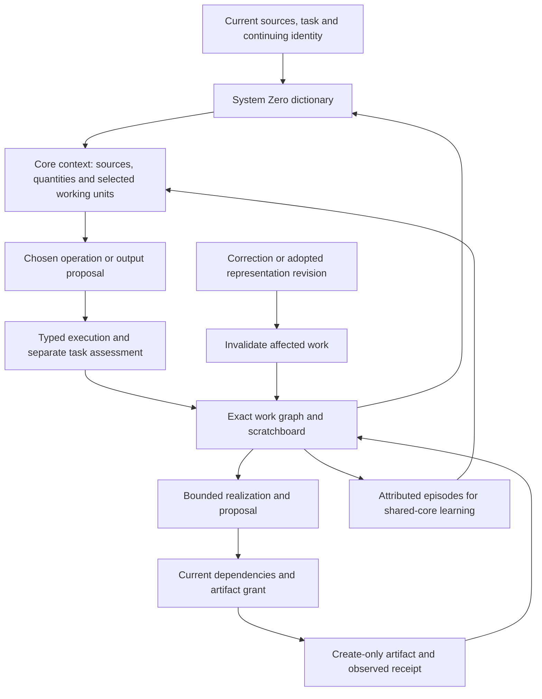

# Modular working representations

The scratchboard is part of the same state model as sources, calculations and artifacts. It represents a working part by its identity, type, content or dependencies, task revision and model basis. The runtime can compose, branch, revise and inspect these parts before producing text. This makes structural modularity an implemented capability. The shared neural core must separately learn which representation and revision solve the task well.

The user requirements retain three connected aims: each part should have a suitable internal structure; useful changes should be possible throughout the work; and every part should fit the complete architecture. A small component or isolated throughput gain qualifies only the behavior it measures. The [joint-core design](system-zero.md) retains language, reasoning, memory, agency, identity, character, creative/perceptual work, compatible capacity and hardware efficiency.

## One connected path



`Harmonizer` projects sources, quantities, observed operations, graph rules and explicitly selected scratchboard nodes from one SJQL journal. `agent.context` uses that same view. It includes at most sixteen working units, labels incomplete previews and binds their exact identities into the proposal snapshot. A current source update, rejected observation, adopted revision or incompatible basis makes dependent proposals stale. Unrelated valid work remains usable.

The present BF16 actor selects a quantity operation and can use information supplied only through a working unit when generating a document. Host code currently selects graph composition and adoption. Learning that editing policy inside nano'ai's joint action head remains part of the neural experiment. A generated proposal still needs the same checks and publication grant as any other output.

## Representations and operations

| Representation | What it holds | Consumer contract |
|---|---|---|
| Literal | Exact UTF-8 text | Explicitly bounded bytes; factual support assessed separately |
| Source span | Source identity and UTF-8 byte interval | Current selected source and valid character boundaries |
| Quantity | Reviewed typed calculation and renderer version | Current observation, units, task review and exact source references |
| Artifact | An observed earlier publication | Actual file bytes, original proposal dependencies and current task/basis |
| Concatenation or repetition | References and a compact composition rule | Current children, finite dependency depth and bounded expansion |
| Slots | Address count, stated intent and sparse bindings | Unbound addresses remain unresolved; intent text supplies no automatic semantic proof |
| Tensor | Exact BF16 or F32 blob, shape and model basis | Byte identity, element count, dtype and compatible numerical consumer |
| Judgment | Question, role, yes/maybe/no, reason, uncertainty and predicate | Prediction and executed property assessment remain separate; current evidence and evaluator |
| Explicit import | Earlier unit, selected origin sources and relevance judgment | Continuing identity, current origin, explicit task relevance and transitive numerical compatibility |

Each immutable node records its specification, dependency snapshot, implementation identity, digest and origin. A revision records the replacement and lineage in one journal event. Historical nodes and published bytes remain available as evidence; active use checks the current version.

| Operation | Preserved property | Effect on other work |
|---|---|---|
| Branch | The current representation becomes another candidate | Both candidates retain their source and shared-child dependencies |
| Revise | Task identity and explicit lineage | Old-version dependents become stale; the new meaning needs assessment |
| Refine | Complete resolved text bytes are equal before adoption | New composition is recorded atomically; dependents reconsider the old version |
| Reshape tensor | Blob bytes, element order, dtype and basis | Shape changes with equal element count; no new numerical information is implied |
| Bind | A new candidate assigns one unresolved slot | The earlier sparse range remains intact |
| Materialize | Exact current expansion within a declared budget | Produces bytes; publication remains a separate operation |

A replacement that depends on the version it supersedes is rejected, including dependencies through calculations, judgment predicates, explicit imports and archived artifacts. Rejection leaves the journal and current version unchanged. A corrected source can support an intentional replacement through a fresh explicit snapshot. The runtime preserves the correction history and requires dependent compositions to be rebuilt deliberately.

Granularity, content, shape, learned capacity and numerical precision are separate axes. Reshaping a tensor does not recover missing detail. Selecting a richer view needs retained source information or additional computation and evidence. Learned width/depth modes and basis changes need qualified consumers. Original BF16 model values and their original F32 auxiliaries keep the existing precision contract.

Producing-model provenance and numerical basis are different dependencies. Exact literal/source/quantity/judgment content can be read after a core-version change when its actual dependencies remain valid. Tensor-dependent compositions retain their numerical basis transitively through steps, artifacts, imports and other working units. Task and continuing-identity boundaries still apply. `board-import` records a deliberate cross-task reuse, with current original sources selected and an affirmative relevance judgment. The runtime validates that declared relationship; it does not certify the semantic quality of the relevance prediction.

## Judgment and experience

`Judgments.generate` asks the actual core for a provisional tagged choice and reason, retains the original generation and binds its source snapshot. A single tagged choice keeps the value and uncertainty cause structurally consistent. It cannot prevent a wrong or unsupported choice. `assess` records a separate result-equality assessment from an executed step. Its value can disagree with the prediction without rewriting it. An unavailable check produces `maybe` with an explicit cause; an absent numerical predicate remains unassessed by that evaluator.

`experiences` derives the prediction/assessment pairs from this same journal. It includes the original model context/output, predicate, source versions, current validity and scope. A current exact result-equality verdict may be selected for predicate learning. Stale or unassessed records remain history and are excluded from that current training selection. General truth, task relevance, broad language quality and candidate adoption require further evidence. The command reports zero parameter updates because recording experience performs no training.

`carry` produces an exact five-trits-per-byte view and a BF16 one-hot tensor with channels `(no, maybe, yes)`. The binary codec uses digits `(0,1,2)` in little-endian base three, keeps the value count, and rejects unused full-byte codes and noncanonical tails. The tensor keeps its declared dependency basis. Neither representation quantizes original model weights, supplies probabilities or changes the judgment's evidence. A different two-bit presentation code must identify its mapping explicitly.

The developmental design trains the shared core to form useful questions, choose representations and act on observations using diverse, reviewed episodes. Current authored questions and exact runtime edits exercise that path's structure; learned question formation and effective self-directed editing remain untrained behaviors.

Future enclosure operators retain their own typed contract. Set uncertainty is a boundary set; quantity uncertainty is an interval with units; statistical uncertainty names its coverage assumptions. A refinement may settle the requested predicate before the interval collapses. Consistent sound constraints can narrow an enclosure, while correction may widen it and conflicting constraints need an explicit conflict state. A learned refinement policy must improve complete-task loss after its total cost. The current `result.equals` assessment does not implement interval arithmetic, statistical inference or that scheduling policy.

## Current bounds and costs

The prototype reserves up to ten million addresses in one range, with at most 256 sparse bindings per range version. Concatenation accepts up to 128 child references, and dependency validation has a depth bound of sixteen. A tensor blob is at most 1 MiB. These are implementation bounds; a reserved address does not allocate a latent vector or contain an answer.

Dictionary previews expand only resolved text of at most 2 KiB. Larger literals expose a labelled prefix; unresolved and tensor nodes carry typed metadata. Ordinary materialization and document proposals use a 32 KiB default. Explicit in-memory expansion can request up to 64 MiB. Large multi-part artifact publication, general tensor arithmetic and learned graph editing require further consumers.

Measurements separate reservation, graph validation, expansion, hashing and output. The capacity consumer compares a one-address range with larger ranges through ten million, then compares exact expansion of known repeated bytes with ordinary byte repetition. Journal replay, hashing and validation are real costs. Total task performance also includes model load, generated choices, retries, source review and publication. [Results](results.md) retain the timings, failures and limits.

## Improving each part and the whole

| Component | Selected structure and reason | Decisive assessment |
|---|---|---|
| Dictionary | A bounded projection of the same durable graph, preserving source and type identity | The model receives the selected unit; stale units fail before action |
| Scratchboard | Immutable typed nodes, sparse ranges and explicit replacement lineage | Branch/revision/refinement, dependent invalidation, exact tensor bytes and actual restart |
| Learned core | Joint representation, workspace, capacity and action learning | Held-out complete tasks, general retention and useful revision choices at matched cost |
| Native execution | Raw resident BF16 with optional measured lossless cold storage | Original values and arithmetic contract, startup, traffic, temporary memory and task latency |
| Recovery | Prepare, create-only publication, observed receipt and current-dependency readback | Actual process interruption, once-only reconciliation and preserved independent artifacts |

Keeping typed interfaces allows the implementation to evolve. It does not require each operation to become a separate model or process. Fusing compatible hot-path operations is useful when the same contracts and measured outcomes hold. The current journal is an exact research foundation; high-volume graph updates and concurrent scheduling need their own workload measurements before a faster store or cache is selected.

The first two learning feasibility paths loaded the complete original BF16 instrument and reached the host swap-growth guard before a gradient completed. A distinct mapped-source CPU path is assessed in the [results](results.md). The working structural path, training resource cost and learned capability keep separate statuses.

## Running the consumer

With the dependencies from the [repository guide](../README.md):

```sh
python tools/evaluate_scratchboard.py --config .local/core/core.json --out .local/scratchboard-evaluation
python tools/evaluate_judgments.py --config .local/core/core.json --out .local/judgment-evaluation
```

The frozen panel requires actual model choice, use of a code available only through the selected working unit, exact Turkish notes, source correction, rejected stale proposals, process interruption and fresh recovery. It records the capacity benchmark and native process resources separately. The broader integration suite also exercises all BF16 word patterns, typed steps, source memory, vocabulary adapters and process lifetime.

The judgment panel records four authored model predictions separately from independently executed property outcomes. It exercises both carriers, dictionary context, generated output, fresh experience retrieval, cross-model exact-unit compatibility and source invalidation. Prediction accuracy and unsupported prose are reported alongside the integration checks.

## Relations, revision and encoding

The [joint-relation path](relations.md) uses the same Steps journal and exposes its checked images as judgment nodes. A judgment with cause `both_alternatives` keeps the question and parent relation, including witnesses for both outcomes. A pending observation is a different state. The shared scratchboard can carry these judgments in exact binary and BF16 views, with source/basis dependencies retained.

The schematic's middle arrows explicitly mean both revision and encoding. A revision preserves history and invalidates affected dependents; a carrier conversion preserves the referenced meaning. Conservative extension can add a new open direction while leaving previous joint alternatives unchanged under projection. These exact mechanisms are separate from learning how to use them well.
