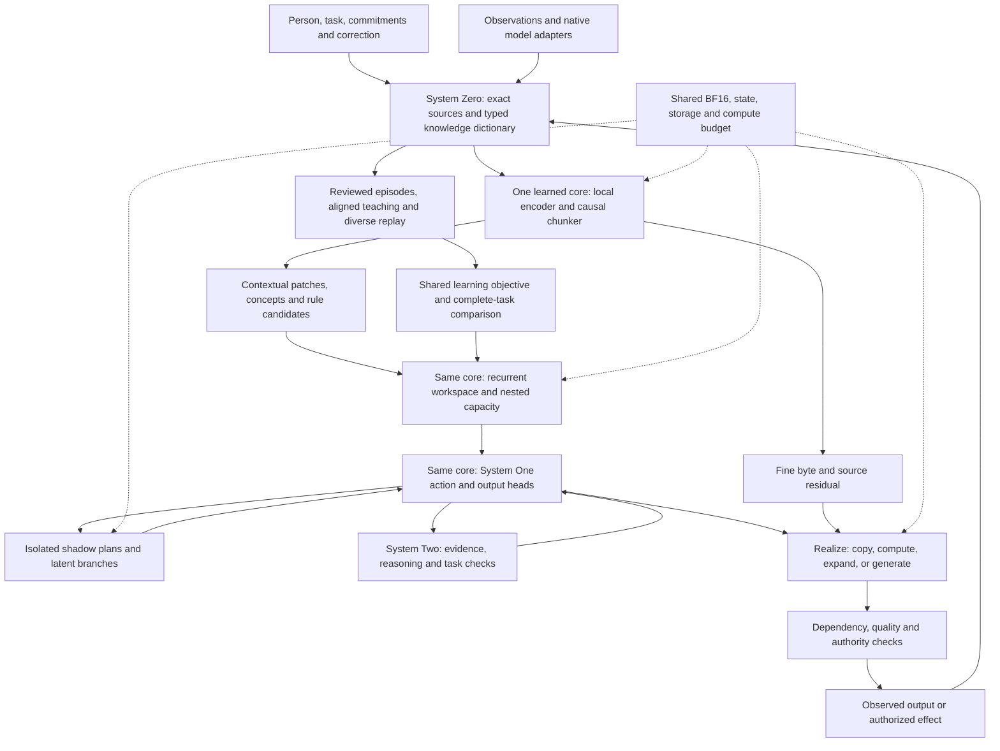

# System Zero and Quantum tokening

The [consolidated architecture](../../NANOAI-ARCHITECTURE.md) governs development order and the distinction between the current generative instrument, bounded feature learner and destination byte/patch core. This document supplies their representation, probability and learning interfaces.

System Zero provides a common, source-bound representation of exact bytes, evidence, operations and reusable work. A single jointly trained core learns how to interpret that information, form patches, retain working state, allocate capacity and propose the next action. These learned functions share an objective and a model identity. System One is the core's acting computation; System Two is additional deliberation and task assessment when those can improve the outcome.

This design retains the whole agent: useful language and creation, perception, continuing identity, character and virtues, correction, memory, agency, Matryoshka capacity, shadow computation and efficient BF16 execution. The existing Qwen model is a control and an experimental instrument. The intended result is a separately trained and evaluated nano'ai architecture.

## Decision and alternatives

The observed baseline has working source revision, typed operation and recovery contracts. The real 2B model initially added a count to a length and generated invalid reference text. Typed quantities exposed the first error; a source-bound quantity menu plus exact rendering completed the revised consumer with retries. Qwen's tokenizer also normalizes decomposed Unicode, whereas the acquired Kimi tokenizer preserves it. These observations motivate distinct exact and learned interfaces.

The decisive question is: **can a context-sensitive choice of representation and reusable work remove expensive learned computation while preserving task meaning, recoverable information and complete outcomes?**

| Approach | Useful property | Decisive cost or weakness | Role |
|---|---|---|---|
| One flat union of all native token IDs and embeddings | Simple-looking common interface | IDs name unrelated learned rows; more entries enlarge the output problem; token merging transfers no learned computation | Replace with namespaced witnesses |
| Native model bank with an exact shared dictionary and typed task graph | Preserves existing models and makes evidence, operations and reusable outputs explicit | Adapter and model costs remain; durable records alone do not train understanding | Implemented foundation and comparison route |
| Jointly trained byte/patch encoder, recurrent semantic workspace and variable-action decoder | Can concentrate deep computation on new decisions and use cheaper local realization or exact reuse | Requires new training, compatible state and complete-task quality evaluation | Selected neural destination |

The second route supplies evidence and teaching data for the third. Fable's architecture review identified a training problem in an earlier version: separately supervised concept, granularity, workspace and shadow controllers had no adequate joint teaching signal. The selected design puts those learned decisions inside one core. The dictionary remains a view of exact sources and assessed claims. A new mechanism earns adoption through useful outcomes and full cost. Individual component gains are not multiplied together without a combined consumer.

## One dictionary, several kinds of meaning

“Common” means a shared contract for referring to information and computation. Every entry retains its kind and qualifications.

| Entry | Identity and content | Permitted inference |
|---|---|---|
| Literal surface | Exact bytes, byte boundaries and each native tokenizer witness | The bytes are equal; their learned meanings can differ |
| Native representation rule | Source revision, normalization, merge/pretokenizer rules, control roles, template and adapter version | The declared tokenizer can interpret its own input/output protocol |
| Evidence span | Source identity, revision, exact range, original bytes and access scope | This source contains these bytes |
| Contextual claim or concept | Proposed meaning, referents, scope, time, units, assumptions, supporting and opposing evidence, reviewer/learning version | Meaning and support have the recorded assessment; a fluent statement alone is a hypothesis |
| Executable rule | Typed inputs, preconditions, operator implementation, result schema and effects | Execution establishes the specified relation under its inputs; it does not establish that the selected problem is the right one |
| Reusable text or work block | Complete bytes or a deterministic expansion, dependencies, provenance, checked properties and destination | The same compatible obligation may reuse the observed work after validation |
| Learned code or state | Model/genome, basis, encoder/decoder, state schema and training objective | It can be consumed by a qualified learned module of that version |

Alias links connect these kinds. A word can refer to several concepts, one concept can have several expressions, and sources can disagree about the same subject. The harmonizer retains those distinctions. Exact byte equality can create a literal alias automatically. A semantic alias requires contextual evidence and assessed learning or review. Contradictory claims remain separately retrievable, with the conflicting relationship recorded.

The original byte source remains available when the active representation is coarse. Normalization keeps both the original and the native model's normalized view. Changes invalidate dependent representations and work. A new query can reopen detail that was previously deferred. Merely retaining that detail does not prove a decision used it correctly.

## Computation through the whole system



The learned core receives a current task, relevant dictionary entries and its compatible workspace. It chooses among a source observation, an exact operation, a reusable block, a latent reasoning update, a generated patch, or a permitted action proposal. Selection itself is learned and fallible. The graph records the proposed operation, observed result, dependencies, review and remaining obligation.

Quantum units may cover one byte, a subword, a phrase, a retrieved passage, a typed relation or a learned patch. These units have different contracts. There is no requirement to convert every internal step into a word. Conversely, a source reference or latent code counts as a reference or code until its requested output is actually produced.

Independent work can run concurrently. Dependent semantic decisions retain their causal order. The scheduler counts simultaneous weights, experts, recurrent/attention states, branches, local decoders, buffers and application headroom. Colibri's expert cache and movement mechanisms inform conditional-capacity execution. They do not make the dense reference model sparse or establish speed for this new architecture.

## The learned computation

The exact working representation now has its own [scratchboard contract](scratchboard.md). Text, source spans, reviewed calculations, artifacts, compositions, sparse unresolved ranges and exact tensor blobs share the work graph. Dictionary v2 exposes selected working units and structural rules to the model context. Graph dependency identity continues through generation, revision, materialization, publication and recovery. Branching preserves candidates; adopted revisions invalidate old dependents; refinement checks exact text bytes; tensor reshape preserves bytes and basis.

This is structural modularity in the runtime. The intended shared action head learns how to select and edit those structures alongside representation, memory and capacity. Current host-directed graph edits and the original BF16 model's generated choices remain separately identified. Every component is assessed for its own function and for its effects on the complete path. Compatible kernel fusion can improve a hot path while retaining the modular data and state contracts.

Typed judgments now share that graph. Each preserves the exact question and current evidence, prediction or assessment role, reason, uncertainty cause and evaluator version. The executable `result.equals` assessment checks only its stated numerical property; task relevance and broad truth remain separate. A derived experience pairs the original prediction with that assessment and excludes invalidated evidence from current predicate-training eligibility. Packed ternary bytes and BF16 one-hot tensors are optional carriers of these records. The real consumer exposed incorrect predictions and unsupported generated prose despite passing its structural checks, as recorded in [the measured results](results.md).

Development through use therefore has distinct steps: gather a complete episode, assess the relevant outcome, retain errors and corrections, select current qualified examples, train a separate candidate with diverse replay, and evaluate retention and complete tasks before admission. The judgment-derived experience view performs no model updates. The later developmental experiment trains a separately identified byte/native-feature recurrent selection candidate from assessed document experiences; its negative quality result remains separate from the proposed generative core. A developmental analogy guides curriculum and continuing identity; it supplies no biological equivalence or evidence of acquired character by itself.

The neural candidate consists of a local byte encoder, a causal boundary/route predictor, a larger recurrent or hybrid global processor, a versioned memory interface, and output heads for bytes and typed actions. They train together. A patch is an internal computation unit; its length is not a certificate of semantic completeness or permission to copy a stored passage. The exact source stream is preserved outside the latent bottleneck. A fine-resolution residual path supports spelling, identifiers, digits, quotations and details the coarse representation misses.

Let `b` denote available input bytes, `z = E(b, context)` contextual local representations, `r` a learned boundary/route decision, and `m` the current workspace. The proposed transition is:

```text
patches, deferred_refs = select_units(z, r, task, compatible_modules)
m_next, work_proposal = core(m, patches, current_dictionary, task)
observation = execute_or_observe(work_proposal)
output_plan = choose_realization(m_next, observation, task)
```

`select_units` can defer expensive processing while keeping exact references. It cannot erase obligations or infer that an unexamined detail is irrelevant. At generation, a boundary or route depends only on the available prefix and state; future-byte leakage would invalidate the comparison. Evidence encoding and causal output decoding have separately declared attention masks. A learned route must save an actual operation or transfer; multiplying a dense result by a mask afterward saves no such work.

The decoder can generate fresh language, emit exact source spans, realize reviewed calculations, or compose compatible blocks. A reusable phrase cannot certify a new claim merely because that phrase was correct elsewhere. Its conditions, referents and dependencies are part of selection and evaluation. A latent merge similarly requires a trained compatible operator; otherwise select or replay from the common parent.

[H-Net v2](https://arxiv.org/html/2507.07955v2) supplies evidence for jointly learned contextual chunking in a hierarchical encoder/global-network/decoder. [BLT v1](https://arxiv.org/html/2412.09871v1) supplies a different byte/patch design with entropy-based segmentation. Their results motivate alternative encoders. Neither paper measures this knowledge dictionary, continuing agent, hardware policy or their combined quality.

## Learning from multiple models

Harvesting a vocabulary acquires an encoding resource. Learning knowledge or behavior requires teaching signals and a trained consumer. The import preserves each source's license, revision, native token IDs, normalizer, template, full embedding/head meaning and original numerical precision.

The first compatible teaching route is reviewed generated examples over the same original sources. Complete sequence likelihoods and intermediate features require separately qualified alignment or projection maps. Adding embedding rows or token probabilities by matching spelling does not perform that alignment. Native normalization differences remain explicit. A donor's unavailable complete runtime cannot be replaced by cropped matrices or a vocabulary file as a teaching source.

[Cross-tokenizer distillation](https://arxiv.org/abs/2402.12030v3) studies learned transfer between different tokenizers. It supports evaluating an aligned teaching objective, while leaving teacher error, task correctness, capacity and this system's performance to their own checks. Teacher disagreement is evidence to retain and investigate, rather than a vote that establishes truth.

### The probability contract

Let `decode(t)` concatenate the literal bytes of a token history. For a byte prefix `b`, the raw teacher distribution conditions on every minimal token history whose decoded bytes cover `b`, including tokens that extend past its final byte. The next-byte distribution sums the masses of these mutually exclusive histories and their continuations, then divides by the mass of `b`. Histories ending exactly at `b` contribute both next-token continuations and termination mass. Fixing one native prompt tokenization instead defines a different conditional distribution and must be labeled that way.

[Vieira et al., v1](https://arxiv.org/html/2412.03719v1) give exact and approximate algorithms for the decoded token distribution. Exact coverage can grow exponentially with prefix length; their beam pruning trades exactness for cost. [Phan et al., v2](https://arxiv.org/html/2410.09303v2), Remark 1, instead assumes zero probability for provably noncanonical encodings after truncation. A trained softmax can assign these encodings positive probability. These are distinct target laws, even when their predictions are close.

Every soft teaching record must therefore name the teacher, native tokenizer and decoding rule, prompt bytes and chosen conditional law, normalization residual, terminal/control treatment, numerical precision, and complete or approximate coverage. An approximate record reports retained mass or a qualified error bound when available, plus its pruning budget; it carries no exact-law claim. Byte conversion preserves a specified model distribution, not factual truth. An ensemble adds teacher and alignment cost. A weighted mixture of fallible teachers is a teaching hypothesis, evaluated against independently assessed outcomes.

The current native client generates text and supplies no complete byte-conditional soft target. Reviewed hard examples are the implemented-compatible starting route. Full cross-tokenizer soft distillation remains a separate consumer to qualify against exhaustive short-prefix checks and real teacher logits, with all branches and termination included.

### One core, shared training objective

The proposed objective combines a byte/action prediction term on reviewed commitments, diverse language replay, trajectory and correction outcomes, retention and conduct, plus measured computation cost. Conceptually:

```text
loss = language_and_action_targets
     + replay_and_retention
     + reviewed_trajectory_outcomes
     + calibrated_cost_penalty
```

These terms update the same encoder, chunker, workspace, capacity route and output heads. The exact graph does not receive gradients. Chunking/routing estimators and the treatment of nondifferentiable task outcomes are declared in each training recipe. Patch count times active width/depth is a cost proxy until calibrated against real kernels, memory traffic and total task time. Hard fidelity, source-integrity, memory and authority conditions remain external constraints; a reward cannot purchase permission to violate them.

An execution receipt establishes that an operation happened. A separate verdict establishes only the assessed task property. Teacher output and agreement are additional evidence fields. They never automatically become correctness labels. Failed proposals retain their exact context, rejection reason and any independently assessed correction. General language, reasoning and creation data must accompany the very small local task journal; its observed successes alone cannot teach broad capability.

Keep data roles separate: teaching/training, controller calibration and final evaluation. Hold out source documents, task families, unfamiliar names and paraphrases. Include late corrections, negation, conflicting evidence, ambiguous concepts, interrupted effects and cases where reuse is inappropriate. General-language replay protects the broader capabilities while a specialist learns. Compare the complete candidate with a capable original-core/retrieval control at matched information and total cost.

## Shadow computation, memory and capacity

A shadow object is an uncommitted continuation, operation, plan or compatible latent state. Its record names the parent task/source versions, model basis, state, budget and expected outcome. Branches should represent useful alternatives in interpretation or work. Their complete state stays isolated until a chosen path has been revalidated.

Preparation can reduce response-path delay by constructing likely useful work early. Its time, energy, resident memory and unused branches remain part of total cost. Current requests take priority, and corrected dependencies invalidate preparation. This mechanism can be particularly useful when a trained actor predicts stable future needs; its advantage is an empirical question.

The work graph and exact archive support recovery. Learned memory develops through episodes and requires compatible encoding after model updates. A relevant source correction can invalidate an entire mixed latent segment; rebuild or replay from a valid checkpoint unless a narrower repair has been qualified. A reusable exact operation result, a stored source span and a neural prefix state each retain their own dependency keys. Low entropy can propose reuse; it cannot establish those dependencies.

Matryoshka width/depth modes and conditional experts are trained with their consuming bases and states. QM chooses useful interventions at declared ports. Hypertensoring composes compatible operators. Binary and ternary layouts can carry exact BF16 words, indexes and discrete decisions; their benefit depends on the native consumer. A ternary sign code is neither a truth value nor a guarantee of sparsity. New trained ternary arithmetic retains a separately admitted model identity.

## Very large output

Distinguish three costs: choosing and verifying new meaning; expanding a compact representation; and materializing or displaying the requested bytes. For `B` emitted bytes and measured sink rate `R`, completed materialization requires at least `B/R` time. Parallel generation can reduce some dependencies but does not remove that output work.

Ten million tokens may describe a large existing corpus, a repetitive expansion, a structured data product or a wholly new argument. They have different information and verification costs. A compact plan can specify enormous regular content; it does not prove that ten million new, independently supported decisions were made. Prepared text can be retrieved quickly, but preparation and dependency checks still count. Novel coherent output also needs global consistency, factual grounding and appropriate termination.

The architecture therefore supports three explicit delivery forms: a fully materialized artifact; a complete source-bound representation with on-demand views; and an unfinished generation with its remaining work. The requested form determines completion. A fast first useful result and eventual full materialization have separate measurements. The system does not report a reference, summary or provisional block as the requested complete output.

When tokenization changes, compare matched tasks, exact output bytes, correctly conveyed facts, latency distributions, memory and energy. A larger token that represents a paragraph can improve useful work per model decision, but a changed token counter alone is no speed result. Universal, instant, error-free novel output is not an established consequence of the design. The current document-proposal implementation has a 32 KiB content bound. Large multi-part artifacts and lazy views described here require their own implementation and consumer checks.

## Implementation and deciding order

The current implementation has native BF16 generation, typed source/calculation operations, versioned task memory, artifact publication, interrupted-process recovery and valid-work reuse. System Zero adds source-pinned Qwen/Kimi vocabulary adapters, a common exact-byte lexicon, native-ID relation tables and explicit normalization residuals. `Harmonizer` derives evidence, declared quantities, executable rules and observed results from the same journal. The actual BF16 consumer passed 24 bounded checks after this integration, including English/Turkish notes, correction and process interruption. These parts have real consumers; the contextual neural harmonizer and variable-action model have not yet been trained.

1. Establish the exact shared representation and dependency contracts. Exercise every imported native entry, literal/control separation, Unicode, source changes and fresh-process readback.
2. Connect evidence, rules, observed calculations and reusable blocks to one typed dictionary view of the existing task journal. Show that correction invalidates affected use and that unrelated valid work survives.
3. Audit the real teaching corpus, freeze family-level splits and exercise a bounded BF16 adaptation of the existing instrument. Preserve complete inputs and distinguish independently checked actions, teacher preferences, failed proposals and repetitions. Generated complete-task outcomes and regression checks accompany likelihood and agreement. This tests the available signal and local training path; it does not construct the destination brain.
4. Compare fixed-token and causal learned-byte-patch students on diverse authorized text and trajectories. Match data, training work, parameter/head accounting, resident memory and task information. Use held-out bits per original byte, generated complete tasks, retention, latency tails and resource cost. Compare fixed patching, learned patching, workspace and nested-capacity variants within the same core. A failed candidate changes that candidate or training recipe; one small experiment cannot retire the wider Quantum requirement.
5. Qualify variable-action realization and shadow preparation through the shared core and exact graph. Account for rejected work, latent state, verification and materialization. The current exact source/operation dictionary remains a reference view; a separately trained semantic store is added only if it improves the complete comparison.
6. Broaden conditional capacity, personal education, perception and creation through their own representative consumers, while preserving the same source, state, identity and learning contracts.

The order supplies executable feedback between stages. A stage can yield a negative result that changes the design. It cannot stand in for the remaining whole-system requirements.
