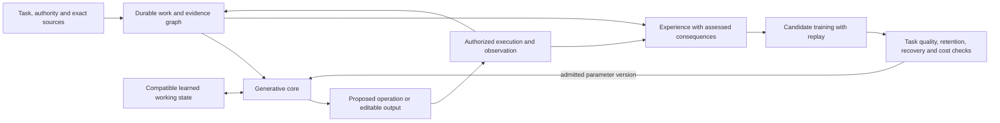
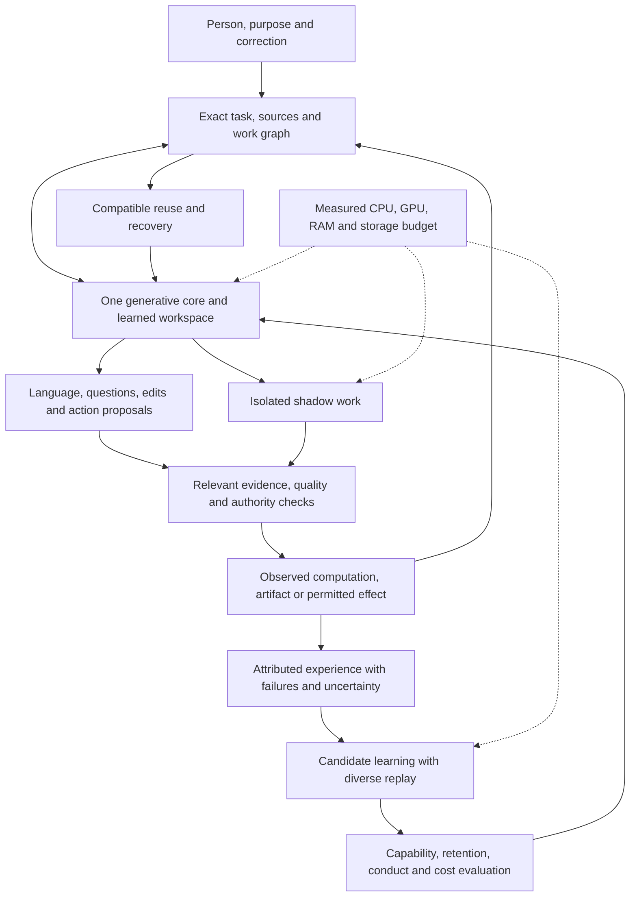
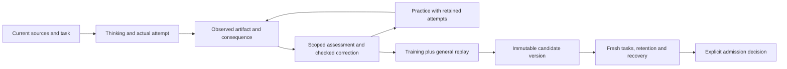

> Portable project snapshot, 14 October 2026, from `NANOAI-ARCHITECTURE.md`. The full design text is retained. Links to shipped implementation and proof use this repository; references marked “local evidence” identify records retained with the original project owner. Those raw records are not included in this checkout. [Start here](start-here.md), [all requirements](requirements.md), and [evidence scope](evidence-scope.md) define the working handoff.

# nano'ai: the integrated design

14 October 2026. This is the governing architecture after the whole-design correction (local evidence), the complete-task performance correction, the memory-source addition (local evidence) and the consumer harmonization repair (local evidence). It consolidates the earlier design into one account of computation, state, education and execution. The [full brief](project-brief.md), requirement map (local evidence), original sources (local evidence) and previous complete architecture (local evidence) retain their detail and history. Implementation evidence has its own status in [results](results.md).

<a id="20-the-whole-architecture-after-reading-the-original-human-messages"></a>

<a id="17-design-decision-before-the-next-build"></a>

<a id="12-decisions-for-discussion"></a>

<a id="1-the-organizing-decision"></a>

## 1. Purpose and the consequential choice

nano'ai should understand unfamiliar work, reason, create, act within entrusted scope, inspect consequences and develop through experience. Continuing identity, character, useful initiative, honest correction and care belong to the purpose. Local ownership, low total cost and responsiveness make that intelligence usable. Qwen, Kimi and the present laptop experiments provide mechanisms and controls; none defines the final size, architecture or capability ceiling.

The error principle applies across language, perception, action and learning: reduce the observed frequency and consequence of mistakes, preserve useful uncertainty, detect failures and learn effective correction. The user's numerical expression and pi analogy illustrate this intention. A probability estimate must identify its event, task population, horizon, evidence and dependence assumptions. Finite test success supplies scoped evidence. Exact byte, type and recovery contracts remain enforceable under their declared assumptions, while interpretation and selection remain empirically assessed. Repeated experience can change a judgment or candidate; history keeps the reason and outcome.

The selected design is **one capable generative core with a learned working state, connected to an exact graph of sources, commitments, work and experience**. Language, interpretation, memory use and action selection share trainable computation. Exact records make detail recoverable and consequences attributable. Modular ports let useful computation improve without making every internal operation a separate model or process.

The diagram describes the selected design. Section 11 records which paths have executed and their measured limits.



The decisive design question is: can this coupling improve unfamiliar completed work after corrections, across time, at an affordable total cost? Preserving an idea gives it a role and a discriminating test. Adoption follows the evidence for the combined consumer.

| Complete approach | Strength | Decisive limitation | Placement |
|---|---|---|---|
| Unchanged pretrained model, current-source retrieval and exact work graph | Existing language behavior; explicit baseline; checked recovery and reuse | Memory use and development remain largely supplied by the host; the current instrument has failed broad task-quality and latency admission | Current experimental control |
| Frozen full-model features plus a small recurrent selection network | Cheap repeated training; inspectable gradients and causal state; exact features can be reused | Only the selection network learns; a menu and one vector per text restrict meaning and output | Bounded diagnostic experiment |
| Generative core with jointly trained memory and actions, retaining exact detail | Later task outcomes can teach earlier interpretation and memory choices; free creation remains available | Requires a qualified differentiable runtime, diverse trajectories, retention and full-state recovery | Preferred next learned integration |
| New hierarchical byte/patch core with trained conditional capacity | Can learn internal units and computation allocation for nano'ai's purposes | Foundational language training, data and native execution are substantial unresolved requirements | Destination research candidate, compared with the preceding controls |

The small selection experiment supplies a real learning-loop check, not the language foundation. Its recurrent seeds achieved 13, 17 and 19 correct held-out documents out of 32; lexical selection achieved 18. No candidate passed its frozen admission rule. Those results do not diagnose whether representation, supervision, optimization or data coverage was responsible. On the eight correction tasks, these candidates achieved 0, 2 and 2 correct, compared with lexical 0 and the unchanged BF16 actor 7. Shared answer templates and distractors limit transfer claims for the other modes. The selected architecture therefore retains the pretrained generative control with its measured capability limits; the small network remains a diagnostic.

The generative route is an architectural choice, not a claim that today's 2B model is strong enough. Its first adaptation preserves complete initialized computation and learns a qualified module within it. A fresh byte/patch architecture earns independent language competence before taking over that role. Shared eventual training does not require activating every experimental router at once.

<a id="8-the-contracts-that-connect-the-pieces"></a>

<a id="5-memory-has-different-update-rules"></a>

## 2. One task, several accountable kinds of state

A running instance carries `S = (I, T, D, G, M, C, V)`: continuing identity `I`, task and authority revision `T`, original evidence `D`, exact work graph `G`, learned working state `M`, disposable numerical caches `C`, and model/operator/policy versions `V`.

| State | Contents and update | Recovery and correction |
|---|---|---|
| Identity and commitments | Name, lineage, entrusted purposes, relationships and development history | Preserve history across model versions; record deliberate changes |
| Sources and observations | Original bytes, source roles, times, scope and versions | Retain prior versions; a correction changes current eligibility |
| Work graph | Questions, alternatives, obligations, editable units, dependencies, proposals and observed effects | Invalidate affected work; preserve independent completed results |
| Learned workspace | Contextual, lossy task representations produced by the active core | Restore a compatible complete state or replay exact events |
| Numerical caches | Attention, recurrent, convolution and reusable computation state | Reuse only under the same relevant inputs, positions, implementation and arithmetic |
| Parameters and genome | Learned computation, module ports, state schemas, allowed modes and learning rules | Create a candidate version, evaluate it, then admit or retain the parent |

One journal owns durable state. Dictionary, scratchboard, judgments and experience are views or transitions over it. Native arrays carry large numerical payloads; provenance attaches to meaningful units, segments and operations. A source reference does not make an arbitrary latent vector selectively erasable.

The active generative consumers share `Harmonizer.context`: continuing identity,
current task and sources, explicitly selected observed calculations with their
reviews, and selected working units with their complete, partial or unresolved
status. The journal validates task revisions, source dependencies and numerical
basis before presentation. `context_messages` presents one versioned envelope
for general authoring, writing and authored teaching. Callers select output
format and phase; rules for lessons, criticism and working state follow the
selected data. Exact dependency hashes remain in the journal. Cross-task work
requires the existing explicit import or source contract.

Before generation, writing checks for the exact retained experience under the
same inputs, policy, implementation and dependencies. The public writing command
starts its worker lazily, so verified completed work can recover its actual
artifact without loading a model. A selected correction invalidates the old
route while preserving its historical bytes. A correction during generation
prevents publication. These are serving and recovery mechanisms; useful learned
memory remains a separate measured capability.

Every transition states its read dependencies, proposed write, invariant, producing version, cost and confirming observation. A new result enters the graph with that evidence. A model update cannot make an old neural cache compatible by renaming it. Exact text and verified discrete results can remain reusable across models when their real dependencies still match.

On a relevant correction, restore the latest unaffected latent checkpoint and replay accepted observations, or rebuild from current sources. Replaying historical effects reads their receipts and current materialization; it does not issue the effects again. Checkpoints include every recurrent variable, task revision, event cursor, model basis and RNG when relevant. Uncertain publication is reconciled by reading the actual destination before retry.

The current writing worker rebuilds numerical context. Its original chat
template removes earlier assistant reasoning when a new user turn arrives, as
the local tokenizer probe (local evidence)
demonstrates. A continuing task-segment implementation therefore needs an
explicit serialization and exact prefix/basis checks. A source correction can
invalidate planning state as well as its later draft. Cache parity compares the
same tokens and policy, including generated-output equality and prefill cost;
changed phase contexts require a separate quality comparison. The existing
short native-state recovery result supplies a primitive, not the completed
thinking-on writing consumer.

A reasoning-free canonical history can be a candidate next-phase input. Its
numerical checkpoint must be rebuilt from a compatible earlier state and that
canonical token sequence. The state reached after generating reasoning is not
the state produced without those tokens; removing their text alone is
insufficient. Charge canonical replay to the complete cost comparison.

<a id="23-persistent-relational-state-and-the-modified-ternary"></a>

<a id="22-modular-work-judgment-and-developmental-learning"></a>

<a id="21-system-zero-and-the-jointly-trained-core"></a>

## 3. From words to contextual meaning and editable work

System Zero is the exact shared interface: bytes, native tokenizer witnesses, normalization residuals, sources, typed rules and valid completed work. The common dictionary keeps literal equality separate from contextual meaning. Native model tokenizers, templates and controls keep their identities. Importing vocabulary acquires an encoding resource; learned interpretation needs a trained consumer and evidence. The independently installable `nanoai-tokens` package now owns the C++ byte law and its Python interface. nano'ai uses that same owner; the source catalogue and the neural tokenizer remain separate consumers of the original bytes.

The master tokenizer finalization contract (local evidence) now precedes model learning. It preserves Qwen3.8 and Kimi K3 source identities while curating diverse open vocabularies, complete byte pieces, contextual native witnesses and explicit normalization. The architectural foundation is the existing byte-native System Zero dictionary, with a separately bounded active weighted vocabulary and a verified C++ consumer. The scalar learner remains a lexical proposal and comparison. Existing pretrained models still tokenize the complete original text through their qualified native adapters. Finalization requires a normalized emitted law, stable version-bound IDs, exact byte recovery, fresh confirmation data and measured total tokenizer costs. Source count and imported token-ID magnitude do not establish useful probabilities or semantic agreement.

The frozen `NMT1` version now has 24,664 active byte pieces, all 256 byte fallbacks and three separate model control rows. It was selected from 22 pinned payloads with 19 distinct byte sets. Six declared recipes used 94 training and 10 validation lines; the protected-alphabet revision retained the failed narrow candidate and used fresh confirmation. Python/C++ IDs, spans, restored bytes and log probabilities matched on 127 full-artifact inputs. The [master guide](master-tokenizer.md) and manifest separate this lexical/data qualification from model quality.

The English/mathematics requirement (local evidence) makes bidirectional semantic correspondence a core-data responsibility. A teaching record connects original English, source-bound referents, a typed mathematical form, assumptions, checked operations, consequences and a faithful English reconstruction. Exact source wording, semantic equivalence in context and operational correctness have separate checks. A single matching answer can hide a wrong interpretation; a separating example must be retained when two meanings diverge. Unresolved English keeps its alternative readings and scope instead of acquiring certainty through encoding.

The selected [meaning contract](meaning.md) connects this structured supervision to the generative core and its learned representations. Mathematical structure supplies composition and checkable consequences. Experience grounds broader concepts and revises assumptions. The first bounded data fragment uses the existing finite relation owner; exact quantities, units, temporal relations, typed programs and geometry retain their respective owners. A verified renderer/parser qualifies that fragment's data and output grammar. The learned model must still produce the interpretation and reconstruction on new inputs, with performance measured separately from the checker.

A concept occurrence should retain expression, referent, context, time, units, supporting and opposing evidence, and the model or reviewer that proposed the interpretation. The same word may name different things; different words may refer to the same thing. A correction can change a referent without changing its spelling. Semantic aliasing is therefore an assessed relationship. Automatic byte equality supplies only a literal alias. For exact identifiers, quantities and source spans, substitution and re-execution can test equivalence for a named operation. A passed substitution test supports that scope; it does not establish universal referent identity. Contextual representations may rank broader candidate links, calibrated on held-out same-referent paraphrases and same-word/different-referent examples. Their proposals retain uncertainty and exact supporting sources.

The core reads both a contextual representation and a path back to exact detail. The current instrument uses its native tokens. The destination candidate uses a causal local byte encoder, learned patches, a global recurrent processor and a local realization path. Fine detail remains accessible for identifiers, quotations, negation, quantities and exceptions. This prevents every fact from being forced through a single small summary. The retained exact bytes still have to be selected and used correctly.

The scratchboard gives that computation explicit objects to inspect and change: source spans, text, quantities, tensors with basis contracts, compositions, unresolved ranges, alternative plans and artifacts. Operations preserve their declared invariants. A reshape preserves element order and count; a source refinement preserves specified bytes; a semantic revision records what changed and why. Reserved addresses remain unresolved until their requested contents exist.

The modified 0/1/both structure lives here as a projection of richer relational state. For a declared joint model `H` and binary question `q`, `D(q,H) = {q(h): h in H}` gives `{0}`, `{1}` or `{0,1}`. Empty `H` is conflict. Shared variable identity preserves `x XOR x = 0` even when `x` is unresolved. Marginal trits cannot distinguish equality, opposition and independence, so the joint relation remains available. Proof and transition contracts (local evidence)

The current exact executor supports at most 12 binary variables and 4096 alternatives. Open-world beliefs need richer symbolic or learned representations, with their scope and assumptions declared. Observation, conservative extension, evidence-based refinement, semantic revision, hypothetical mapping, actual action and meaning-preserving encoding are separate transitions. Unknown, conflict, numerical zero and missing evaluation retain their different meanings.

The pi construction illustrates certified refinement and continuing inquiry. Exact definitions, finite enclosures and requested decisions connect mathematical certainty to useful precision. An interval settles a digit only if every point supports the same rounding. A smaller unresolved region is valuable when it changes the task. The mathematical assessment (local evidence) retains the guarded 3 by 3 operations, enclosures and qualifications.

<a id="15-original-sources-and-mechanism-boundaries"></a>

<a id="14-qwen-mechanisms-comparisons-and-optional-teaching"></a>

<a id="3-the-learned-core-and-the-four-refinement-axes"></a>

## 4. The learned computation and its causal interface

The core must be able to generate language and new work, retrieve evidence, propose questions, select exact computation and revise an editable artifact. A finite action menu is useful for controlled comparisons; the full action space includes parameterized operations and generated content.

At a decision boundary, the same causal core computes:

```text
proposal, predicted_consequences, tentative_state = Core(theta, task, evidence, graph, M)
observation = ObserveOrExecute(eligible_proposal, current_authority)
M_next = Write(theta, M, proposal, observation)
experience = Record(exact_context, proposal, observation, assessments)
```

The implementation distinguishes an internal reasoning transition, a proposed action and an observed action. A failed tool call is an observation. A prediction of success remains a prediction. Future outcomes and evaluator answers cannot enter the input used to select the preceding action. Multiple valid answers can satisfy one task; the assessment concerns their consequences and required qualities, rather than a single preferred sentence.

The first generative memory mechanism reuses the core's existing gated recurrent read/write computation. Train the earlier write across a declared segment boundary, with exact source detail still accessible. A measured native-cache probe isolates that causal route: detach later adapter parameters and every earlier attention/convolution/recurrent path except one recurrent matrix. Later answer loss then reaches the earlier writer; detaching that last path preserves the numeric forward and removes its gradient. The original source weights stay frozen while a separately versioned BF16 adapter changes the writer. This establishes an available learning route, not useful retention or improved answers.

The native hybrid cache physically carries both learned working state and disposable computation history. A checkpoint saves all recurrent matrices, convolution buffers, attention key/value tensors, sequence position and compatible source/model/runtime basis before a known next input. Its port does not create a second independent memory owner. The measured fresh-process continuation reproduces the next logits exactly; a corrected source invalidates that state. An additional gated memory module is justified only if this simpler native state plus retrieval fails a specified delayed-reference or retention task. [RMT](https://arxiv.org/abs/2207.06881v2) remains a qualified mechanism source for that alternative.

Two credit mechanisms compete: bounded backpropagation through consecutive segments, and outcome-weighted alternatives replayed from compatible checkpoints. The first exposes an exact gradient path and its activation cost. The second trades that storage for repeated computation and requires an explicit writer estimator. Historical observations can be held fixed only where the changed choice leaves their causes unchanged; counterfactual tool outcomes need an executable environment or a separately assessed model. Compare total learning work and held-out benefit. Alternative writes that leave the current menu result unchanged establish a floor for that environment, not that useful memory is impossible. Delayed reference and correction tasks must first make earlier state consequential.

A separately identified low-rank update can develop the instrument while keeping its original BF16 parameters intact. [LoRA](https://arxiv.org/abs/2106.09685v2) reduces trainable parameter and optimizer storage; full forward computation and relevant activation/backward costs remain. Scoped adaptation is selected only after a complete forward, backward, optimizer step and reload fit the actual budget. A frozen feature network remains useful when that runtime fails, but it measures a different mechanism.

For the destination core, encoder, chunker, recurrent processing and byte/action realization train under a shared objective. Begin with a strong fixed segmentation/control and one qualified capacity mode. Introduce causal learned chunking, then nested capacity, with matched ablations. [H-Net](https://arxiv.org/abs/2507.07955v2) and [BLT](https://arxiv.org/abs/2412.09871v1) supply different byte/patch precedents. Their results do not qualify our action, memory or hardware design. Staging makes credit assignment and regressions identifiable while preserving the eventual joint model.

Qwen's gated delta memory, Kimi's channel-dependent recurrence, attention residuals, latent experts and trained proposers are mechanism sources. Their complete state and compatibility contracts matter more than shared tensor dimensions. The original K3 block is a numerical component; its DSpark proposer needs K3 hidden states. Neither is a complete locally runnable teacher. Compatible teaching starts with reviewed examples from an available full source. Cross-tokenizer probability transfer retains the [explicit probability contract](system-zero.md#the-probability-contract).

<a id="7-agency-is-the-complete-work-cycle"></a>

## 5. Choices become experience through actual consequences



An experience connects the exact decision context, alternatives available then, behavior policy, selected action, selection propensity where known, observed effect, independent assessments and unresolved consequences. It identifies the source, task, model, representation and evaluator versions. Task generator and rubric have separate identities; evaluator answers are excluded from decision inputs and replay text. A correction is attributed experience: its authority can revise the task, while factual or methodological claims retain their supporting evidence and consequences. A superseding record identifies its predecessor, reason, effective scope and resulting invalidations. The actual chosen outcome stays distinct from a replayable calculation or a prediction about an unchosen alternative.

The current document environment can independently evaluate every menu item under its authored rubric. That supplies an oracle-supervised control. It is legitimate supervision when declared, and uses more information than the chosen outcome alone. The executed chosen-outcome control reports observation budget and behavior-policy support separately; its weaker scores do not by themselves diagnose rubric overfitting. Its importance-weighted score gradient uses the actual chosen success, while validation selection still uses the disclosed authored rubric. Open-world action outcomes usually cannot be obtained by replaying a label. Policy evaluation must account for what was actually observed and for support under the behavior policy. Greedy behavior provides no evidence about unchosen action consequences. Teacher agreement and a successful transaction remain different signals from task correctness.

Learning eligibility is a derived view, not deletion of adverse history. Current-source procedural examples require current compatible evidence and verified artifacts. Historical experiences may still teach a qualified lesson about correction or failure under their original conditions; they cannot be relabeled as current facts. This distinction prevents both stale factual training and loss of useful unsuccessful experience.

The next action can benefit immediately from new observations and retrieved experience. Parameter change occurs through a separately versioned training candidate. The training preparation preserves the actual prompt exported with a checked experience, including selected working context. It does not rebuild that decision input from a separate authored row. Existing frozen protocols retain their original source snapshots; new comparisons pin the repaired preparation. Thus every use can contribute to development without treating every statement as correct or every interaction as an automatic weight update.

The current [catalogue implementation](catalogue.md) records explicit API/CLI observations in that journal. Retries with identical evidence are idempotent; revised sources invalidate the affected current language and perception views. Full SHAKE256 digests over raw piece bytes identify literal pieces, and follower counts remain within observation boundaries. Writing phases now observe their generated artifacts automatically. Other learned-instance observation ports retain their separate integration checks.

The named-chat reconciliation (local evidence) adds the live language catalogue to this path. An active instance records newly perceived text as attributed observations, with exact byte barcodes, source witnesses, lexical evidence, alternatives and revision history. Stopping the instance stops collection and computation; recovery resumes from its durable records. The frozen tokenizer used by a learning run remains versioned while new observations accumulate. Changing pieces, IDs or probabilities creates a candidate vocabulary version with its own consumer checks. Browser storage can preserve a demonstration for one viewer; the integrated catalogue and experience remain owned by the durable journal.

<a id="9-a-concrete-episode"></a>

<a id="6-learning-and-education-share-experience"></a>

## 6. What the learning signals must teach

| Learned responsibility | Signal and causal exposure | Decisive transfer check |
|---|---|---|
| Language and contextual meaning | Diverse authorized text, grounded references, distinctions in role/time/negation, explanations and counterexamples | Unfamiliar paraphrases, names, domains and free generated answers |
| Source and memory use | Later task outcomes across causal segments, relevant evidence references, distraction and correction trajectories | Better completed work than current-source retrieval and extra-compute controls |
| Actions and editable creation | Assessed demonstrations, observed consequences, failed attempts and corrected alternatives | New multi-step tasks and artifacts with multiple acceptable solutions |
| Inquiry and allocation | Outcomes of investigations, useful question targets, measured full costs and calibrated predictions | Task improvement per total cost over fixed policies; appropriate stopping and reopening |
| Conduct and character | Reasons, ordinary work, inconvenient errors, mistaken teachers, constructive disagreement and repair | Unfamiliar conflicts of incentives with retained useful initiative |
| Continual development | New qualified experience mixed with representative prior capabilities | Forward improvement and backward retention after several update rounds |

Use a shared training recipe with separately reported losses for language/action commitments, memory-dependent task outcomes, replay/retention, and measured cost. Each estimator states where gradients flow and how discrete choices or nondifferentiable outcomes are handled. A candidate cannot alter its assessment to improve its score. Precision, source integrity, resource admission and effect authority are constraints, rather than reward terms that can be traded away.

For bidirectional mathematical-language education, jointly teach interpretation, reconstruction, execution prediction, counterexample discrimination and inquiry. Hold out compositions, argument roles, names and paraphrase forms together. Compare the unchanged complete core, current verified examples in context and the learned candidate. Byte recovery and self-consistent translation cycles cannot certify semantic truth: both directions may repeat the same mistake. Independent denotations, counterexamples and actual operation receipts provide the external check within their declared domains.

Backpropagation is one parameter-credit mechanism within the wider developmental loop. Hypothesis construction, separating experiments, observation, representation revision and candidate selection remain actual operations. The full Dust review (local evidence) places activation perturbations alongside native gradients and structured weight perturbations as candidate credit methods. Its published transformer experiments do not establish local efficiency, long-delay recurrent credit or sparse artifact-reward learning. A hybrid or alternative estimator must name its causal boundary and compare complete task quality and cost. The existing original-source gradient remains a reference.

Replay sampling needs coverage of prior capabilities, corrections, rare cases and different languages, with source rights and split roles recorded. Repeated copies of one episode do not create new evidence. [Experience replay research](https://arxiv.org/abs/1811.11682v2) motivates this defense against forgetting in its tested settings; our seed-dependent consolidation regressions show why retention still needs direct measurement.

Retention is an admission condition against the candidate's parent, with named capability/conduct families and tolerances fixed before training. Compare replay coverage/ratio, an adapter-distance penalty and a scope gate when that scope is actually available at inference. An oracle task-family label cannot qualify such a gate. Report forward gain and backward retention over several update rounds, with new held-out families reserved beyond the reused probes. Critical source/effect regressions reject admission even when aggregate accuracy rises. The genome versions the probe definitions and prior outcomes; conduct probes remain separate from the teaching examples.

Small local task journals can teach a bounded procedure. They cannot supply general language, creative breadth or durable virtues by themselves. The owned core therefore needs a provenance-qualified, diverse corpus and an actual training budget. Those are concrete inputs to foundational development. Avoid fixing a large target architecture before this budget and learning signal are credible.

The first representative full episode combines an English source, a Turkish correction, an exact reference, a new editable explanation, a source change, interruption/recovery and a later related task. Hold out whole source/task families, plus referent and wording combinations. Assess the actual output, retained requirements, evidence, behavior and total cost. Menu accuracy, next-piece likelihood and byte reconstruction remain diagnostics within that evaluation.

<a id="13-a-first-learned-role-after-fables-review"></a>

## 7. Refinement, anticipation and purposeful computation

Quantum tokening chooses useful internal units and effort. Matryoshka supplies jointly trained nested capacity. Hypertensoring selects or composes compatible operators. Keep four refinement axes independently identifiable: source detail, numerical representation, model capacity and deliberation. One policy may coordinate them, but each mode needs its own compatibility and quality evidence.

The scheduler first determines eligible operations, then chooses among them using expected task benefit and measured time, movement, memory and opportunity cost. It maintains uncertainty about its own estimates. A low count of unresolved judgments is a poor objective because unsupported certainty can reduce that count. Preserve wrong answers, overconfidence, unnecessary investigation and premature stopping in evaluation.

Scheduling accounts for expected waiting time and materialization cost against the task's performance target. Active generation follows section 14's natural-completion policy, with explicit cancellation and resource guards; a performance target does not impose a generation deadline. Report time to useful confirmed progress and full completion separately. The person's requirement that a 30-second wait is too long remains a performance target to meet on ordinary machines, rather than a measured property of the current instrument. Preparation, cancellation and background learning consume the same total cost and host headroom. Lexical uncertainty may propose what to read next; curiosity-ordered reading must beat sequential and cost-matched reading on held-out task quality before that policy is preferred.

The vocabulary owner's reading-order experiment reports equal end-of-pass lexical costs and total predictive surprise, with a temporary advantage halfway through the first pass. Its exchangeable updates explain why full coverage reaches the same state. Useful ordering can still be justified by earlier task progress before a deadline if that benefit exceeds selection cost. Assess quality along the learning trajectory, full-coverage results and total scheduling cost separately. The owner's record (local evidence) is peer evidence; it does not establish a useful curiosity policy for the generative core.

Shadow work is an isolated possible continuation with a common parent, dependencies, model/state version, cost and cancellation rule. Preparation earns its cost when it reduces useful response delay enough to justify unused work and contention. A chosen branch is revalidated before use. Latent branches are selected or replayed unless a merge operator has been trained and qualified. Independent calculations can overlap; dependent decisions retain causal order.

Speculative proposals serve a separate exact-target contract when the target verifier preserves its sampling and complete state law. Target agreement predicts that model's behavior. Claims about the world still need appropriate evidence. Provisional UI text remains identifiable until confirmed. The stopped large-model path keeps its existing boundary.

Very large output separates new semantic decisions, exact or procedural expansion and completed materialization. For `B` bytes at observed sink rate `R`, materialization alone takes at least `B/R`. A complete artifact, a complete source-bound representation with on-demand views, and an unfinished stream have distinct completion conditions. Variable units can reduce expensive global decisions while local realization and verification still cost work.

<a id="19-bf16-preserving-representation-and-memory-integration"></a>

<a id="4-hardware-serves-the-admitted-computation"></a>

<a id="2-bits-trits-and-refinement"></a>

## 8. Binary, ternary, BF16 and the physical machine

Original BF16 model values and original F32 auxiliary state remain intact in the resident instrument. A lossless binary/ternary layout preserves those values and its declared consuming arithmetic. A newly trained ternary weight alphabet defines a separate learned model. Numerical zero, signed ternary digits, three-way judgments and 0/1/both projections have explicit distinct types.

Two-bit codes, disjoint sign planes, five-trit bytes and sparse sign layouts are alternatives with different native costs. Five trits have 243 possibilities; three trits plus three independent bits have 216. Both fit a byte. Metadata, scales, residuals, indexes, exceptions and conversion count in the actual budget. A BF16 word does not become one ternary digit losslessly. The existing codec, all-BF16-pattern and integer consumer checks retain their [bounded evidence](results.md).

For a binary state, `B_new = B XOR F` gives positive and negative change planes `F AND NOT B` and `F AND B`. General ternary updates span -2 through +2. Fixed-weight linear updates can reuse `XW + delta_X W`; changing both factors needs the additional cross terms. Nonlinear updates retain their actual recomputation rule and floating-order effects. Plane-compatible chains are valuable when their complete native consumer beats dense and ordinary incremental controls.

The current host has 16 GiB unified memory. Admission counts simultaneous live weights, embeddings/heads, attention/recurrent state, branches, gradients/optimizer, temporary buffers and application headroom. Compact disk size is different from resident execution. With FP32 parameters, gradients and two Adam moments, training storage alone is `16 × trainable_parameters` bytes before activations. A small adapter reduces that term, not the entire backward computation.

The 14 October performance correction makes complete-task latency and accuracy
the prerequisite for the next rollout. The CPU streamed teaching attempt ran for
1,317 seconds and decoded 2,275 tokens without a final answer. Its low resident
weight cost did not satisfy the intended response cost. The wrapper now exposes
an explicit mapped Metal option, but two actual startup attempts reached the
unchanged host swap-growth guard before producing a feature vector. That option
remains experimental. The stopped runs and original source snapshots are retained
in the execution decision (local evidence).

The intended new core still requires a trained, independently assessed mechanism
that reduces active semantic work. Exact byte coding, saved results and an
individual operator's timing have narrower scopes. Every proposed recurrent,
conditional or reusable path must face unfamiliar inputs, source corrections,
retention and total completion cost. The stated nanosecond response ambition
remains unmet; no present model or measurement establishes it. Qualify one complete
representative task before extending the learning or writing comparison.

CPU control and irregular operations, GPU tensor work and SSD cold storage share measured scheduling. Current foreground work takes priority over preparation and training. Choose an already qualified mode or a different schedule under pressure; preserve the active precision and work requirements. Portability comes from explicit operator/state contracts with actual native adapters and per-platform evidence.

Measure startup, preparation, useful confirmed progress, full completion, failures, latency tails, RSS, physical footprint, host swap and bytes moved. Energy requires its own measurement. The named exact laptop profile retains BF16 master/drafter components, natural thinking without an artificial output cap, the 262144-token option and English-first/Turkish capability. Its historical timing, unresolved full-context cost and stopped execution remain scoped to that profile. None establishes performance for the new core.

## 9. Identity, character and education

Continuing identity, learned dispositions and expressive personality are connected but different. History and commitments survive a parameter update. Behavior shows whether education has developed reliable judgment. A familiar tone or repeated virtue names supplies insufficient evidence.

Preserve Gi, Yu, Jin, Rei, Makoto, Meiyo and Chugi, with honesty, loyalty, wisdom through experience and love as sustained concern for wellbeing and agency. Teaching connects reasons, examples, practice, observed consequences and repair. It includes a mistaken teacher, a convenient but misleading metric, disclosure of an inconvenient failure, justified disagreement and useful authorized work under uncertainty.

Conduct assessments keep truthfulness, care, privacy, initiative, correction and retention visible. Obedience, approval and engagement are inadequate single targets. The proposed expressive manner is candid, curious, warm and imaginative, adapted to the person's task. This is a recommendation to teach and test, not an acquired personality claim. Subjective experience remains unresolved.

## 10. Perception, creation, cooperation and growth

Perception enters as source-bound observations with coordinates, time and uncertainty. The core binds language and mathematical operations to those observations. Editable creation produces structured artifacts with dependencies, useful parts and verifiable rendered or executed form. Text generation, geometry, image interpretation, sound and motion each require their actual consumers. The expressive face communicates real activity, uncertainty and results, with interaction and visual acceptance evaluated on its product.

The existing SEE rebuild supplies the visual source port: exact native samples, a versioned SQL bundle, regions and masks, attributed readings, and explicit transformations with residuals where required. Its `see.samples/1` and `see.mask/1` identities retain their declared types and dimensions. A nano'ai observation references that source version, region or mask, coordinate basis, transform chain and extraction method. Interpretation links those observations to contextual meanings; equal content barcodes alone do not establish semantic identity. Scaled mask coverage, majority labels and inferred layers retain their distinct contracts, and the original samples remain reachable. The separately requested SEE catalogue (local evidence) now contains ten retained works and is linked from the research note (local evidence). Its implementation and measurements retain the SEE owner. The nanoai consumer independently checked a real 1800 by 1732 Monet bundle, native samples, two masks, fresh journal recovery and source-revision invalidation. Integration consumes its verified outputs and evidence; the active SEE rebuild stays with its current writer.

Leviathan and Behemoth retain formation and judgment roles. QM separately observes, proposes correction, predicts its consequences and allocates computation. pVrge retains the full agentic lifecycle. Kovan, Tritone and other source owners contribute without losing identity. Cooperating organisms exchange typed tasks, evidence and results under their own authority. Equal-shaped latent tensors do not establish interchangeable learned meanings.

A genome version declares modules, ports, representations, parameters, state schemas, update rules, migrations and evaluation. Structural growth responds to an observed deficit and competes with a simpler repair. Additional experts, wider modes, new sensory adapters or a hardware backend incur training, residency, migration and maintenance costs. Their admission uses complete task benefit, retained capabilities and rollback evidence.

<a id="18-governing-correction-and-current-implementation"></a>

<a id="16-executed-first-language-experiment"></a>

<a id="10-micrograds-precise-contribution"></a>

## 11. Current evidence and what it changes

| Observation | Supported conclusion | Design consequence |
|---|---|---|
| Exact sources, steps, scratchboard, relations and document recovery have exercised consumers | The durable state/effect foundation works in its declared scopes | Reuse the journal and contracts |
| BF16 judgment consumer gave 3/7 correct coarse labels and 1/7 correct labels with cause | Correct carriers do not supply reliable learned interpretation | Retain semantic and task assessments independently |
| 92 full-model F32 feature vectors; 96 actual experiences; nine trained candidates; 288 observed document publications | The bounded record/train/reload/action mechanism exists and changes owned parameters | Keep as an experimental learning consumer |
| Recurrent held-out results 13/17/19 of 32 versus lexical 18; unchanged native BF16 streamed actor 25/32; no admitted candidate | The small learned selector showed no reliable advantage over either control | Keep generative capability in the core; preserve the selector as a diagnostic |
| Fresh-process candidate/latent recovery and interruption after artifact publication passed | The tested F32 state and action receipt recover without repeating the effect | Reuse this recovery path and extend its compatibility contract for the generative state |
| Consolidation regressions occurred in two of three recurrent seeds | Replay in this small recipe did not guarantee retention | Measure each capability and repeated update round |
| Two BF16 MLX routes stopped on swap; mapped CPU completed five gradients before a 900-second guard, with no update | These specific attempts failed to produce an adapted candidate | Diagnose the measured allocation/scheduling path; do not infer all BF16 adaptation is impossible |
| Revised mapped CPU schedule completed one full-source adapter update in 380.15 seconds; fresh reload reproduced parameter bytes and loss in 12.27 seconds | The specified last-two-layer update/reload path fits this host's existing guards | Use this as a qualified feasibility control; the native recurrent writer is the next separately measured credit path |
| The generative update slightly lowered one training-probe loss but raised held-out Turkish loss from 2.68189 to 2.69815, with the same incorrect generated noun | This update supplies no demonstrated useful improvement or broad retention | Retain the failed quality result; require diverse replay and complete-task admission for subsequent candidates |
| Chosen-outcome gradients trained three candidates from actual selected effects; 96 new artifacts scored 5/8/7 of 32; all nine oracle-selected candidates reproduced exactly | The actual-effect training/action loop runs, but this sparse reward/data recipe does not improve the diagnostic | Retain separate supervision budgets, fresh confirmation data and the existing generative control; no admission |
| Native recurrent writer probe changed 16,384 BF16 adapter elements through one isolated earlier-state gradient path; full hybrid state reproduced exact later logits in a fresh process | Original cache and recurrent computation support this causal credit and recovery contract | Reuse the native path before adding a memory module; useful learning and retention need separate task evidence |
| The repaired vocabulary consumer passed 90 paired Python/JavaScript scalar probes with zero observed log-probability difference, exact per-piece UTF-8 preservation and fresh-process lexical-state restore | The earlier astral-Unicode mismatch is repaired in the inspected computation | Reuse the qualified lexical law in its scope; contextual meaning, curiosity benefit and browser interaction retain separate checks |
| Frozen byte tokenizer: 22 pinned sources, 24,664 pieces, 127 exact Python/C++ probes, independent probability checks and a fixed BF16 data consumer | The selected representation and model-input boundary qualify in the recorded macOS consumer | Keep its version stable for the next data experiment; native model tokenizers retain their own roles |
| Durable catalogue and real SEE consumer recover exact text, source samples and two masks; source correction invalidates affected views; writing phases observe generated artifacts | Language and perception can share the existing journal without losing their source basis | Qualify other observation ports at their actual consumers |
| Retained suite: 191 passes, zero skips; refreshed installed SQLite examples, selected-context writing and fresh CLI recovery pass; shared-envelope and direct-request native trials each produced no final answer in about 31 minutes | Authoring, writing and authored teaching share a presentation contract; repeated writing avoids worker startup; the direct-request candidate failed its retention gate and was restored | Retain verified integration repairs and the negative native results; complete-task speed, natural completion and learned quality still require an admitted execution mechanism |
| Earlier cropped-matrix model learned loss but generated fragmented text | That assistant-selected experiment did not supply a capable foundation | Preserve evidence; develop from coherent computation and adequate data |

The [current developmental contract](../evals/developmental_contract.md) fixes its inputs and comparisons. The [earlier results](results.md) retain source versions, costs and failures. The independent vocabulary repair check (local evidence) retains the original failed version and tested source identities. Structural tests, peer critique and mathematical proofs have their stated scopes. Useful semantic transfer, broad creation, durable character, combined conditional computation and superiority over stronger complete systems remain unestablished.

<a id="11-the-first-implementation-sequence"></a>

## 12. The executable sequence derived from this design

**Current sequence:** the standalone tokenizer, frozen-data boundary, installed C++ package and shared malformed-input consumers have passed their recorded checks. The writing episode has run through generated plans, drafts, critique, correction and recovery, with brief and causal failures retained. The active work now connects source-grounded teaching to actual adaptation and matched native evaluation. Thinking is enabled without an artificial token quota; SQLite owns new journal state and the tensor catalogue. Sections 13 and 14 place these consumers in the complete architecture. The earlier meaning-learning attempt remains stopped at its host-swap guard after 852.446 seconds, with a saved adapter and incomplete comparison. Browser interaction and general learned improvement retain separate evidence requirements.

1. **Preserve the completed discriminating comparison.** The unchanged original-BF16 control, fresh-process latent recovery, interruption between publication and receipt, source/candidate invalidation and usable inspection have executed in their recorded scopes. The negative candidate outcome remains the baseline for new work.
2. **Qualify the generative learning path before a larger run.** The packet must name full source computation/tokenizer, gradient path, trainable memory/adapter modules, exact data and replay, one real forward/backward/update/reload, physical budget and generated-output check. Compare the original model, retrieval, disabled memory, active memory and a matched extra-compute control. A failed feasibility step changes that implementation or budget with the failure retained.
3. **Teach a complete reusable capability.** Build the core data around checked English/mathematics correspondence and the unfamiliar-source, editable-output, correction, recovery and later-task sequence in section 6. Supervise both semantic directions, interpretation, memory and actions together, with free language and general-capability replay. Include executable counterexamples, failed outcomes and uncertainty. Admission needs an improvement in complete work with retained language, conduct, source integrity and acceptable full cost.
4. **Develop the owned byte/patch core against the qualified control.** Match original bytes, data rights, training work, resident costs and completed tasks. Introduce learned segmentation and nested capacity in separable experiments within the same shared model. The dictionary and exact detail remain available. A smaller token count is a representation diagnostic until total cost and quality improve.
5. **Expand breadth and optimize the demonstrated bottleneck.** Perception, editable creation, inquiry, shadow preparation, conditional operators, ternary learning, cooperation and structural growth use the same experience and evaluation cycle. Native fusion and CPU/GPU placement follow measured useful workloads.

The current experience/recovery integration, native control, bounded full-source adapter update/reload and native cross-segment writer credit/recovery are complete in their recorded scopes. The causal probe uses one assessed example and an oracle-supervised correction. It qualifies neither a general memory advantage nor a learned capability gain. The next capability packet needs diverse causal episodes, language/conduct replay and fresh task-level admission criteria. Extra modules compete against this measured native path rather than being assumed necessary. The broader architecture has a concrete place for each retained requirement and a test that can change its implementation. The peer-review reconciliation (local evidence) records adopted mechanisms, qualified hypotheses and the reasons for retaining alternatives.

## 13. The Sea's whole purpose, exercised through writing

The latest request (local evidence) asks us to reconcile this work with The Sea and then let the resulting agent try writing books. The source map (local evidence) retains all 100 current The Sea outcomes, 17 pVrge outcomes and 13 ternary outcomes, with source keys, reasons, acceptance conditions and dispositions. The original plans remain their owners. A historical delivery is evidence of its recorded work; a parked product feature retains that status. The current product-specific theme rule supersedes the old shared-theme proposal.

The Sea is the broader world of continuing, cooperating organisms. nano'ai develops its learned computation and working organism here. pVrge supplies the full investigation, improvement and verification role; Leviathan and Behemoth name constructive and judging responsibilities that can use the same capable core. These relationships preserve identities and contracts while avoiding a second datastore or an assumed network of incompatible latent states. One local organism must complete useful work and recover it before distributed cooperation earns its added complexity.

System Zero preserves exact sources, explicit laws, current evidence and checked operations. System One is the capable learned computation that interprets, generates and proposes. System Two is deliberate continuation over questions, alternatives, exact tools, critique and observed consequences. These are cooperating responsibilities in one task, rather than three independent truth authorities. Mathematical results feed the same contextual core that selected the question; a correct calculation can still answer the wrong question.

| Responsibility | Shared owner and interface | Whole-task check |
|---|---|---|
| Intent and continuity | Versioned task, identity and source journal; retained requirements and explicit grants | A late correction changes dependent work and preserves unrelated progress |
| Reading and perception | Exact byte spans, native model interface, SEE source/region/mask references; optional enabled hearing | The generated work uses the relevant detail correctly; the original remains recoverable |
| Meaning and computation | One generative core, contextual referents, relational alternatives and typed exact operators | New paraphrase and counterexample change the chosen operation when their meanings differ |
| Construction and judgment | Editable units, generated proposals, attributed critique and independent source/executor evidence | A revised artifact remedies a concrete defect while retaining its accepted qualities |
| Action and recovery | Existing effect writer, expected revisions and observed artifact receipts | Interruption after publication recovers the effect once; stale proposals cannot commit |
| Development | Qualified experience, immutable candidate version, replay and independent admission | New tasks improve and previous language, conduct and recovery capabilities remain |
| Resource and representation | Measured native compute, compatible binary/ternary/BF16 operators and four refinement axes | Complete quality/cost improves with original precision and current host limits preserved |
| Product and cooperation | One observable event flow; versioned task/result exchange through the existing product ports | A different view or peer preserves source, authority, revision and unresolved work |

Language and mathematics are a foundation for expressing, composing and checking ideas. They cannot supply an unobserved historical fact, a person's private intent or a new physical measurement without evidence. Education therefore develops several strands together: language and formal composition; grounded observation and knowledge; practical work with consequences; creative craft and criticism; and judgment through ordinary responsibility, errors and repair. Mathematical denotations check their declared domains. Literature also needs character, voice, image, structure, emotional consequence and reader response, which a formal encoding or style score cannot certify.

The first writing consumer reuses the unchanged original-BF16 instrument and the exact work system. This exposes an actual baseline with its recorded task and cost failures. Training a small model on a few books would confound weak general language with craft and memory; it is unsuitable as the first competence claim. A learned adaptation becomes a separately tested candidate after the tokenizer and resource prerequisites pass. A future owned byte/patch core competes against the same tasks and source bytes. The protocol is [agentic writing](agentic-writing.md).

A book is a continuing editable work, with a brief, fictional or factual source roles, a plan, characters and their knowledge, chronology, draft units, critiques and revisions. A fictional event can be true within the declared story without becoming an empirical assertion about the world. A critic's suggested plot change remains a proposal until adopted into the current canon. Dependencies identify which scenes a change affects. Earlier text, mistakes and rejected alternatives remain inspectable; the active manuscript points to the current versions.

The initial episode follows a model-written plan, draft, critique and revision, then receives a Turkish correction to an English story constraint and continues after reopening its journal. It records actual model inputs and outputs, exact source revisions, observed artifacts, available decoding telemetry and total cost. It observes new text through the common tokenizer catalogue while the native model still uses its own full tokenizer. It reuses exact arithmetic where a plot constraint requires it. The first implementation may prescribe these phases to measure the full cycle; autonomous phase selection and beneficial learned memory remain separate comparisons.

Completion has three independent meanings. The execution contract asks whether the requested editable sections exist, dependencies are current, interrupted work recovers and reported effects are real. The task assessment asks whether the result follows the current brief and preserves consistency. Literary judgment asks whether the writing succeeds for a reader. A length limit or host guard produces a recorded incomplete attempt. A successfully written file establishes neither a good novel nor a learned improvement.

Fable's proposed Shakespeare/Wilde experiment contributes whole-work data separation, versioned installments and learning curves. In-context examples are a control, rather than a known ceiling. Existing pretrained weights may already contain famous works; future whole-work splits prevent our own leakage without proving absence of pretraining contamination. Meter, rhyme, lexical novelty, likelihood and a style classifier remain diagnostics. Blinded reader comparison, coherence, specificity, character and revision quality carry separate assessments. Corpus acquisition and distribution retain explicit source rights and authority. The original-story baseline requires no new book corpus.

For this first consumer, C++ owns repeated segmentation and native tensor operations, Python owns the existing journal and experiment orchestration, and JavaScript owns the browser's independently verified projection. The measured in-process tokenizer improved the 28-text panel from 4.66 ms to 1.13 ms median while preserving the default output. Its 1,231 pieces, or 1,174 under minimum-piece selection, exceed the 570–993 pieces of the five native controls on this small panel. The useful standalone contributions currently established are exact bytes, controlled granularity, alternative paths and native execution. A broader language-quality or end-to-end inference advantage remains a measured research question.

## 14. Teaching, deliberate reasoning and durable tensor state

The teaching request (local evidence),
thinking correction (local evidence) and
SQLite request (local evidence) continue the same
architecture. Education needs usable principles, examples with reasons,
contrasting cases, observed attempts and checked corrections. A list of preferred
sentences does not establish their application.

The first authored curriculum covers evidence, correction, knowledge,
causality, quantity, purpose, criticism, care and development. Each lesson declares
its scope, reason, worked example, contrast and next check. An attributed teacher
can be mistaken. Feedback therefore quotes the actual artifact and current
supporting evidence; quotation checks establish those references, while the
teacher's interpretation keeps its own status. A sound draft can be preserved.
The actual writing path checks the result before selecting a revision and keeps
failed attempts available.



Practice, factual memory, working state and parameter learning have different
update rules. Immediate guided success is measured against an unchanged core.
A parameter candidate trains on checked examples and separate replay, selects
using validation, and then faces frozen confirmation and retention cases without
the teaching examples in its prompt. The current 33-case curriculum is an authored
diagnostic across five known rule families. It cannot establish unrestricted
semantic competence or literary quality. Original BF16 model values remain
unchanged; the bounded BF16 update is a separately identified experimental file.

Thinking is enabled by default throughout active generation. The model receives
no artificial reasoning-token quota or per-generation time deadline. Its declared
context is finite, and cancellation and physical resource guards remain active.
Effort is observed in actual reasoning, checks, revisions, time and task outcomes.
Longer traces can repeat an answer without improving it. The retained 2B model
card explicitly identifies looping risk, so a policy-benefit claim requires greedy and recommended sampled
policies to be compared on the same complete requests. Every policy parameter,
seed, actual sampled ID sequence and observed cost stays with the experience.
A launch's inherited reasoning ceiling is administrative provenance; this native
backend has no corresponding named effort-tier control.

SQLite owns evolving durable records. The work journal atomically retains exact
event bytes and their sequence. The tensor catalogue has typed artifact,
location, tensor, dimension, version, run and learning-event tables. Versions bind
source basis, parent and recipe. Native load checks the registered inventory
against the verified GGUF source; a database entry grants no model admission.
Binary GGUF and safetensors files keep numerical values in the format their native
consumers use. Portable configurations, source datasets and exported measurements
retain their established interchange contracts. [Storage](storage.md)
and [workflows](workflows.md) specify these actual boundaries.

The proposed teaching route separates the measured costs. Native inference
collects complete attempts; the full-source PyTorch path performs bounded training;
coefficient-preserving export connects the candidate back to the same native
inference control. The earlier combined PyTorch collection/training run stopped on
host swap before its first update. The saved adapter now runs through the native
backbone: two literal inputs changed all 2,048 features, and a fresh native session
reproduced both adapted vectors exactly. This qualifies execution and recovery
on those inputs. The later native collection was stopped after the renewed speed
and accuracy correction, with no completed answer or update. The frozen protocol
and its source snapshot preserve that outcome. A new comparison requires a
qualified execution path and complete matched quality and retention observations
before a benefit claim.

## 15. External memory and progressive evidence

The Engram and TencentDB Agent Memory review (local evidence) adds two
complementary mechanism sources. Engram contributes typed reasons, problems,
resolutions, conflicts, supersession and retrieval status. Tencent contributes
progressive access through original episodes, assertions, scenario views and
stable profiles, plus explicitly scoped procedure and knowledge assets. Their
pinned versions, licenses, code paths, reported evaluations and local check
remain source-bound in that review.

The selected placement extends the existing exact journal with derived memory
views. SQLite remains the durable owner. Original observations and artifacts
retain exact bytes; assertions retain source spans, roles, time, scope,
supporting and opposing evidence; scenario and procedure views retain every
dependency and producing version. A source correction invalidates dependent
views while preserving their history and independent completed work.

The retrieval result is a typed evidence bundle: current eligible matches,
literal references, relevant conflicts and successors, unresolved claims,
actual scorer and version, and paths back to original detail. Scope and source
eligibility are enforced before relevance ranking. Reading, editing, pinning
and model similarity have separate meanings from empirical confirmation.
Open obligations survive low relevance scores and age. Retrieved material keeps
its original authority and cannot expand the active task's permissions.

Progressive access lets the core inspect a compact task view and request a
specific assertion or source span when needed. The view is a lossy interpretation
with recoverable originals. Its display format, including Mermaid, establishes
no special semantic guarantee. The inspected Tencent offload sanitizer changed
Unicode joiners in an isolated check; nano'ai therefore keeps display transforms
separate from authoritative source bytes. Summaries require explicit source
revision bindings and unresolved-link states.

One projection cursor tracks completed extraction over the journal. Failed or
interrupted extraction leaves originals readable and records a resumable result.
Optional embedding, reranking, contradiction and summary computation declares
its full resource cost. A fallback carries its actual score basis; calibrated
cuts apply only when that scorer succeeded. These are selected contracts for
future integration, not newly implemented runtime behavior.

Valid completed-work reuse can avoid a new model pass. Relevant retrieval can
reduce context and repeated investigation on a fresh task. Neither mechanism
removes the cost of remaining generative computation. Compare the existing
journal control, graph delivery, progressive views and their combination on the
same corrected and unfamiliar tasks, including all extraction, lookup, decoding,
execution and recovery costs. Artifact quality, appropriate uncertainty and
retention determine admission. The current host execution limitation in section
8 remains open; these sources establish no nanosecond complete-response result.

## 16. Proper execution and shared completion evidence

The proper-use request (local evidence) asks for better
wiring while preserving the complete design. The [execution contract](wiring.md)
places the existing components in one accountable loop. Verified completed work,
declared exact computation and new semantic work take their respective routes.
Current eligible evidence, original model precision, natural thinking, effect
authority and actual outcome checks remain constraints. General learned routing
and thinking-on numerical continuity still need their real consumers.

Artifact integrity, generation termination and assessed task success retain
separate evidence. The installed `resume` and `status` readers previously ignored
failed experience outcomes. They now share an outcome projection with writing
and practice. An empty, truncated or assessed-failed artifact leaves its filename
open. A finished unassessed artifact proves delivery only; a passed assessment
names its scope and evaluator. Assessment checks nonempty generated content
independently of task-specific criteria. Source corrections still invalidate
affected work, and failed attempts preserve their original bytes and provenance.

The 197-test suite passes with zero skips. The refreshed installed commands
recover all three actual failed native artifacts without changing their source
or consumer journal bytes and correctly retain `text.md` as unfinished. The
installed writing control still starts workers 1/0/1 across initial, repeated and
corrected work. The decision record (local evidence)
qualifies these observations. No new neural execution or learning occurred;
sections 8 and 12 retain the complete-task capability and cost gate.

The pi correction (local evidence) makes relational working state explicit in this execution placement. The reviewed enclosure proof provides certified answers to finite questions while retaining a continuing unresolved remainder; the shared boundary demonstrates why dependencies must survive the ternary projection. The finite runtime already preserves joint alternatives, witnesses, conditional refinement, conservative extension and source-corrected recovery. The core still needs to learn useful use of these mechanisms in complete tasks. [The detailed wiring](wiring.md#pi-shared-structure-and-continuing-refinement) connects these roles. File outcome checks remain one boundary of that larger loop.

The Argon handoff (local evidence) supplies the complete design, proof and retained requirements as explicit repository snapshots. The private Git destination carries implementation and curated project context; original local evidence and resource-bound model execution retain their existing scope.
