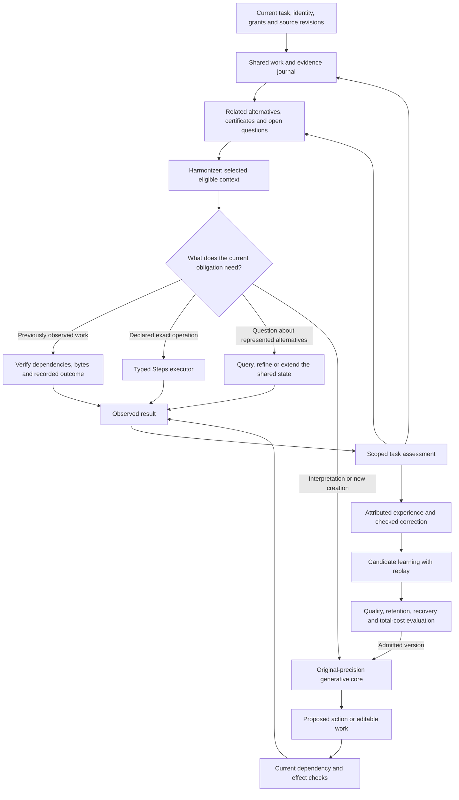

# Using the whole system coherently

14 October 2026. This is the execution placement for the existing
[design](design.md), with the retained whole-system requirements. The current
request asks for better wiring while preserving their substance. The repair and
installed-consumer observations are in [measured results](results.md#shared-completion-evidence-14-october-2026).

## The organizing decision

Use one continuing task, one durable evidence/work journal, an explicit working
state of related alternatives and one capable generative core. Route each operation to the component that can perform it under
its actual contract. The core interprets, creates and proposes; exact operators
execute declared mathematics and transformations; the journal preserves sources,
dependencies, attempts and consequences. Assessed experience returns to the same
task and supplies separately reviewed candidate learning.



The diagram is the target operating loop. The current CLI exposes the individual
routes and `Writing.practice` executes caller-selected phases. General learned
action selection across these routes and continuous numerical writing state
remain unqualified. A new coordinator class alone would not supply either.

## Give each component its proper job

| Component | Proper use | Evidence that must return |
|---|---|---|
| Task and journal | Preserve the full goal, authority, revisions, open obligations and independent completed work | Exact event sequence and source/effect identities |
| System Zero and tokenizer | Recover bytes, literal references, explicit rules and native tokenizer witnesses | Exact spans, declared types and reversible encoding |
| Harmonizer and memory views | Supply relevant eligible sources, unresolved alternatives, reviewed results and selected working units | Selection/dependency identity and a route back to source detail |
| Relational working state | Preserve joint alternatives, shared identities, certificates and the questions they can answer; refine, revise or extend with a stated reason | Witnesses, assumptions, transition identity and correction/recovery behavior |
| Learned core and workspace | Interpret unfamiliar language, choose useful operations, create and revise | Actual input, sampled output, proposed action, compatible state and uncertainty |
| Steps and editable work | Execute declared operations and preserve connected editable units | Actual result, operator version, dependencies and invariant checks |
| Effect owner and assessment | Observe what happened and whether it satisfies the named task criteria | Verified materialization plus an independently attributed verdict and scope |
| Teaching and learning | Use the recorded decision context, consequence and checked correction | Immutable candidate, split provenance, retention, transfer and total cost |

Byte equality does not establish shared meaning. An exact multiplication does not
establish that multiplication answered the request. A teacher's preferred answer
does not replace observation. These distinctions are needed at the interfaces,
where the next component can actually use them.

## Pi, shared structure and continuing refinement

The [reviewed pi proof](pi-proof.md) supplies a precise example of the organizing
idea. On an `n` by `n` grid over the unit square, `Y` cells lie inside a quarter
disk and `M` cells contain both inside and outside points. Integer comparisons
certify each class. Their areas give

```text
L_n = 4Y/n² ≤ π ≤ 4(Y+M)/n² = U_n
M ≤ 3n, so U_n − L_n ≤ 12/n → 0.
```

Pi is the unique real value in every such bracket. Its irrationality means a
rational-endpoint bracket cannot collapse to pi at a finite stage. A finite
requested decision, including displayed digits, can still be fully certified
when the whole bracket gives the same answer. Dyadic subdivision preserves
nested bounds; arbitrary changes of grid size need a containment check.

The boundary cells share one curve. That relation lets the proof bound their
number by `3n`, while the entire grid has `n²` cells. It motivates preserving
shared structure and directing work toward relevant unresolved parts. It supplies
neither a universal convergence rate for thought nor a neural speed estimate.

The operating loop uses this principle in five connected ways:

1. Keep the state, source identities, shared dependencies and alternatives behind
   each visible answer. A `both` result retains witnesses for both possibilities.
2. Ask the task's actual question of that state. A settled answer to one question
   can coexist with other open questions.
3. Choose a useful observation, exact computation or learned proposal. Refine
   under an explicit valid premise and retain the certificate or scoped evidence.
4. Reopen affected conclusions on correction. Extend the state for a new question
   without silently discarding earlier alternatives.
5. Preserve the attempt, consequence and reason for revision as experience.
   Candidate learning is assessed for useful transfer and retained capabilities.

The current [relation consumer](relations.md) implements the finite-state query,
refinement, extension, hypothetical map, witness and recovery contracts in the
same journal. Equal, opposite and independent pairs can have identical marginal
`maybe` labels but different answers about equality. Keeping their joint state
preserves that distinction. The pi demonstration is an independent mathematical
consumer; it is not installed as a general learned refinement policy. Learning
which representation, question and transition are useful remains substantive
core work. The complete [architecture](whole-system.md) retains that objective.

### Completion belongs to the current question

Fable's subsequent design review proposes a task-relative completion rule: deliver
the requested result when its mandatory criteria are satisfied at the declared
tolerance, and retain other open questions in the continuing state. A numerical
enclosure certifies such a decision when every enclosed value gives the required
answer. Declared exact tasks can use their verified result directly. This is a
useful operating rule for inquiry that continues after a completed delivery.

The completion criterion and the production of a deliverable need separate
mechanisms. The current [native worker](../src/nanoai/native_worker.py) requests a
non-streaming completion and returns the model's final content; the
[experience owner](../src/nanoai/experience.py) assesses the observed artifact
afterward. A task owner cannot assess missing final bytes or obtain them merely
by changing the completion rule. An incremental candidate/delivery protocol, or
an applicable exact producer, must supply something that can actually be checked.
The three empty-final trials remain failures until that path is exercised.

Writing checks such as length, required details and canon have their stated
scope. They are not guaranteed numerical enclosures of literary or semantic
quality. The completed question, remaining obligations, evaluator and uncertainty
must remain explicit. Conditional `relation.refine` narrows under a premise;
`relation.extend` adds a coordinate while preserving prior alternatives. Both can
serve continuing work, and their contracts remain distinct. `agent.inquire`,
`Scratchboard.relation`, `documents.relation_note` and `Memory.completed` now
implement this exact-producer path for confirmed `decided` relational queries
while retaining `both` questions (`open_questions`) and keeping incomplete or
empty generative outputs non-completing (`allows_completion: false`).

## Close the loop at its real outcome

Artifact integrity, natural generation termination and task quality have
different observations. The shared artifact outcome now reports:

| Status | Meaning and completion scope |
|---|---|
| `artifact-only` | Current verified delivery through a producer without an experience assessment; quality keeps that producer's explicit contract |
| `unassessed` | A finished, nonempty experience artifact is available; delivery can be recovered, while semantic quality is unassessed |
| `passed` | The recorded independent assessment passed its named scope on these observed bytes |
| `failed` | Generation was incomplete or empty, or the recorded assessment failed; this artifact cannot satisfy the remaining filename |
| `unresolved` | The experience/assessment cannot be bound uniquely to these observed bytes; completion remains open |

`Memory.completed`, `status`, `Writing.run` and `Writing.practice` use this shared
boundary. `generation_finished` reports the decoder stop separately. Current
dependencies and actual artifact bytes still need verification before reuse.
An earlier valid success survives a failed later attempt. Corrected dependencies
reopen affected work; independent completed work remains available. Every failed
artifact and assessment stays in history.

Generated-experience assessment also checks for a nonempty final answer. A rubric
that only asks whether a forbidden phrase is absent can otherwise reward an
empty response. Failure remains usable learning evidence with its original input
and separate corrective target. Updated assessment code has a new implementation
identity; older learning records retain their source version and require the
existing eligibility check before current training use.

## Spend computation where it changes the work

1. Reconcile unfinished publication and inspect current obligations. Reuse exact
   observed work only after dependency, byte and outcome checks. A recovered
   failure returns its status without repeating the same generation.
2. Read the smallest sufficient current evidence view, with access to exact
   detail. Open obligations, exceptions and unresolved conflicts retain their
   place even when a relevance scorer ranks them poorly.
3. Use the existing typed executor for an explicitly specified or reviewed
   operation. For example, the selected period and count can be multiplied and
   the confirmed result rendered through `note` without another model pass.
   Learned interpretation is still needed when the choice of operation is open.
4. Invoke the generative core for the remaining interpretation, creation or
   revision. An earlier unsuccessful native call is evidence to change the
   mechanism or inputs, rather than a reason to schedule an identical retry.
5. Feed the actual result and scoped feedback into the next decision. Practice
   changes the task context; parameter learning produces a separate candidate.

This ordering preserves the original model values and useful work. It removes
unnecessary computation from eligible cases. It cannot make a new semantic task
free: retrieval, restoration, prefill, decoding, execution, assessment and
recording all count toward its latency. Background preparation and learning
consume the same host resources.

## Numerical continuity needs its own qualification

Reuse a native cache only when the exact token prefix, positions, model/adapter,
arithmetic, runtime and every recurrent, convolution and attention component are
compatible. Persist the event cursor and sampling state where needed. A relevant
correction restores an unaffected checkpoint and replays the valid sequence, or
rebuilds from current sources. Replaying observed effects reads their receipts.

The current writing template changes the effective input at a new user turn by
removing earlier reasoning text. Retaining the old numerical cache would retain
those tokens' effects. A canonical next-phase checkpoint therefore requires
valid restoration and replay, with those costs charged to the comparison.
The existing short hybrid-state experiment is a useful primitive; it does not
qualify this complete thinking-on writing path.

## The next mechanism must earn its place

Keep source fidelity, original BF16/F32 precision, natural thinking, actual effect
authority and truthful completion as constraints. Compare remaining choices on
useful complete-task quality and cost. Current-source retrieval and the exact
work graph are the control. Native recurrent memory and a separately versioned
adapter use existing computation before an extra memory network is justified.
The owned byte/patch core, learned refinement, nested capacity, conditional
operators and compatible ternary computation remain in the full architecture;
each needs trained behavior and a real consumer.

Three earlier natural-thinking BF16 attempts each used roughly 31 minutes and
produced no final answer. Prompt presentation changes did not qualify a solution.
Two mapped Metal startup trials also stopped at the host resource guard. These
are concrete limits of the tested paths. The present outcome repair changes
recovery and learning attribution; it does not repair those neural failures.

Before another large rollout, a consequential execution or core change must
finish an accurate unfamiliar task under the retained constraints, then survive
source correction and fresh recovery at acceptable total cost. Learned admission
also needs diverse replay, held-out transfer and retained language/conduct. This
gate preserves the full ambition while making the next experiment decisive.
